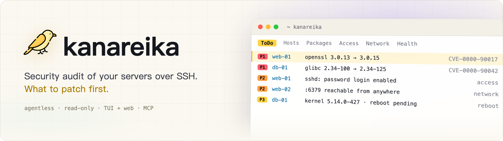
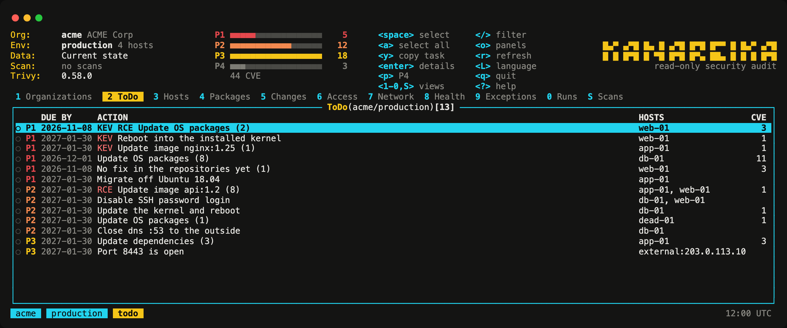
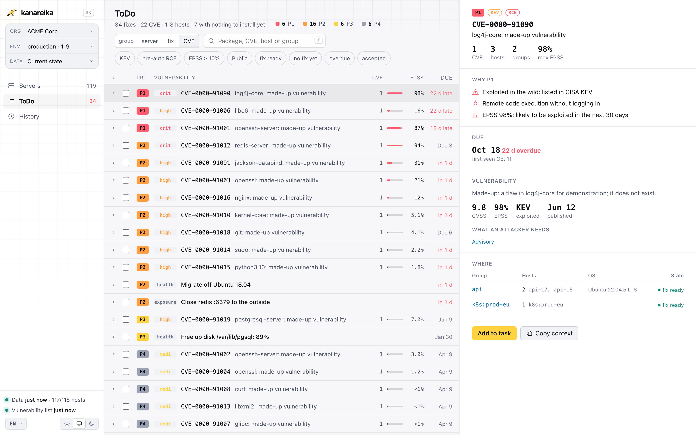

<h1><picture><source media="(prefers-color-scheme: dark)" srcset="docs/brand/banner-en.png"></picture></h1>

[](https://github.com/mikekosulin/kanareika/actions/workflows/ci.yml) [](https://github.com/mikekosulin/kanareika/actions/workflows/coverage.yml) [](https://github.com/mikekosulin/kanareika/releases/latest) [](LICENSE) [](https://github.com/mikekosulin/kanareika)

**English** · [Español](docs/readme/README.es.md) · [Français](docs/readme/README.fr.md) · [Português](docs/readme/README.pt.md) · [Русский](docs/readme/README.ru.md) · [中文](docs/readme/README.zh.md) · [日本語](docs/readme/README.ja.md) · [한국어](docs/readme/README.ko.md)

Agentless, read-only security audit of Linux servers over SSH. It ranks what to patch first: CVEs with KEV and EPSS, SSH access, exposed ports, host health, each with fix steps that can be rolled back. It works the same in a terminal UI, a web UI and through an MCP server for AI agents. One Go binary, one YAML per organization, no telemetry; the data stays on your machine.

- **Homelab**: pick your hosts from `~/.ssh/config` or paste `user@host`.
- **Freelancer**: one organization per client; add servers to it later.
- **Company fleet**: paste a host list, CSV or Ansible inventory; failed logins are grouped by cause, with the fix.

### Terminal interface

Run `kanareika`. It opens on ToDo: what to fix first, most urgent at the top.



### Web interface

Run `kanareika web` for the same data in a browser, with the trend of the last 30 runs.

<picture><source media="(prefers-color-scheme: dark)" srcset="docs/screenshots/web-en.png"></picture>

<sub>Demo data, made up.</sub>

### Install

Homebrew (macOS, Linux); the formula pins the version and its checksum:

```bash
brew install mikekosulin/tap/kanareika
```

Or with the install script — read it, then run it:

```bash
curl -fsSLO https://raw.githubusercontent.com/mikekosulin/kanareika/main/install.sh
less install.sh
sh install.sh
```

It picks the build for this machine, checks its checksum (and the build attestation, when the GitHub CLI is installed) and asks before installing into `/usr/local/bin` or `~/.local/bin`; `KANAREIKA_YES=1` skips the question.

Or by hand (Linux, macOS):

```bash
OS=$(uname -s | tr '[:upper:]' '[:lower:]')                 # linux, darwin
ARCH=$(uname -m | sed 's/x86_64/amd64/; s/aarch64/arm64/')  # amd64, arm64
FILE=kanareika-$OS-$ARCH.tar.xz
URL=https://github.com/mikekosulin/kanareika/releases/latest/download

curl -fsSLO "$URL/$FILE"
curl -fsSLO "$URL/SHA256SUMS"
sha256sum -c --ignore-missing SHA256SUMS  # macOS: shasum -a 256 -c --ignore-missing SHA256SUMS
gh attestation verify "$FILE" --repo mikekosulin/kanareika  # optional, needs the GitHub CLI
tar -xJf "$FILE" kanareika
```

`tar` leaves `kanareika` in the current directory.

Windows (PowerShell):

```powershell
Invoke-WebRequest https://github.com/mikekosulin/kanareika/releases/latest/download/kanareika-windows-amd64.zip -OutFile kanareika.zip; Expand-Archive kanareika.zip -DestinationPath kanareika
```

Then run `kanareika.exe` from the `kanareika` folder. On ARM, take `kanareika-windows-arm64.zip` instead.

### Start

In the terminal:

```bash
kanareika
```

or in the browser, at http://127.0.0.1:8088 (it listens on localhost only):

```bash
kanareika web
```

On first start it walks you through adding your servers (SSH user and key, hosts, consent to scan) and runs the first scan. It asks before downloading the vulnerability list (about 210 MB).

### For scripts and cron

Create an organization; its settings go to `orgs/<ORG_ID>.yml`:

```bash
kanareika org new <ORG_ID>
```

Scan it; the org file is checked and the databases are downloaded first:

```bash
kanareika scan <ORG_ID>
```

The web interface on another port (`--port 0` takes any free one):

```bash
kanareika web --port <PORT>
```

The terminal interface connected to a remote web interface:

```bash
kanareika tui --url http://<SERVER>:8088 --token <YOUR_SECRET_TOKEN>
```

Isolated network: export the databases on a machine with internet access,

```bash
kanareika db export <BUNDLE.tar.gz>
```

then import them on the isolated one and scan offline:

```bash
kanareika db import <BUNDLE.tar.gz>
kanareika scan <ORG_ID> --offline
```

Everything else: `kanareika --help`.

**Four ways in, same data and rules:**

- **TUI** — `kanareika`: `?` for keys, `o` for panels, `L` for language. Attaches to a remote web too.
- **Web** — `kanareika web`: dashboards, trends, host details; scans start from the page.
- **Commands** — for scripts and cron.
- **MCP** — `kanareika mcp`: read-only tools for AI agents (Claude Code and others).

**What it checks:**

- **Vulnerabilities** — OS packages, images, jars and lockfiles via trivy built into the binary; backports and fix availability verified on the host; **P1–P4** by KEV, EPSS, exposure and pre-auth RCE.
- **Access and exposure** — SSH password logins, keys, logins and attackers, open ports, firewalls, external scan.
- **Health** — kernel errors, disks, memory, time sync, pending reboots.
- **Fixing** — selected actions become a ready task for an engineer or an AI agent: apply, verify, roll back.
- **Safe by design** — read-only, organizations isolated, changed host keys refused, no scan without consent, the web interface on localhost only (or with a token).
- **Private** — no telemetry: nothing about you or your servers is sent anywhere, and reports stay on your machine. It only downloads public data: the vulnerability databases (ghcr.io, with mirror.gcr.io and public.ecr.aws as fallbacks), CISA KEV (cisa.gov), EPSS (FIRST, empiricalsecurity.com) and the DB-IP Lite IP databases (db-ip.com), which IP lookups run against offline. Even the embedded trivy's telemetry is switched off.

**Disclaimer.** Kanareika reports what it finds; it does not promise to find everything. Priorities and fix steps are advice: review them before running anything on your hosts. Audit only servers you are allowed to. Provided as is, without warranty ([MIT](LICENSE)).

Like it? [Star it](https://github.com/mikekosulin/kanareika) · Something wrong? [Open an issue](https://github.com/mikekosulin/kanareika/issues/new/choose) (no real hosts or addresses, please) · Vulnerability? [Report privately](SECURITY.md)

[Org file reference](docs/org-file.md) · [Changelog](CHANGELOG.md) · [Contributing](CONTRIBUTING.md) · [MIT](LICENSE)
