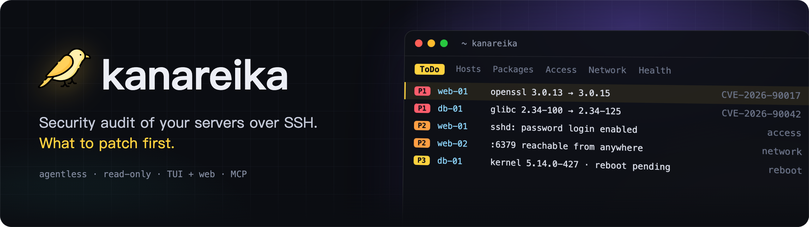
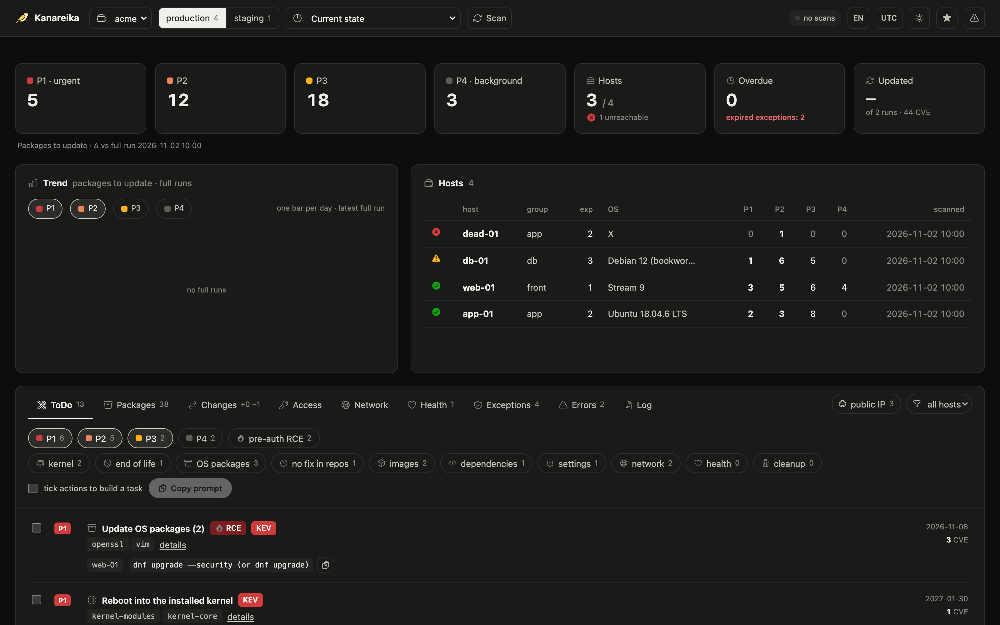

<h1></h1>

[](https://github.com/mikekosulin/kanareika/actions/workflows/ci.yml) [](https://github.com/mikekosulin/kanareika/actions/workflows/coverage.yml) [](https://github.com/mikekosulin/kanareika/releases/latest) [](LICENSE) [](https://github.com/mikekosulin/kanareika)

**English** · [Русский](docs/readme/README.ru.md) · [中文](docs/readme/README.zh.md)

Agentless, read-only security audit of your servers over SSH: what to patch first, who can get in, what is exposed,
whether the hosts are healthy — with fix steps that can be rolled back. One binary, one YAML per organization; the data
stays on your machine.

### Terminal interface

Run `kanareika`. It opens on ToDo: what to fix first, most urgent at the top.


### Web interface

Run `kanareika web` for the same data in a browser, with the trend of the last 30 runs.



<sub>Demo data, made up.</sub>

```bash
brew install mikekosulin/tap/kanareika   # macOS, Linux; or a binary from the release (Windows too)
kanareika init                   # orgs/, secrets/, reports/ here (or --home DIR)
kanareika org new myorg          # hosts, jump hosts and consent: orgs/myorg.yml
kanareika validate myorg
kanareika db update              # vulnerability DBs (isolated network: db export / db import)
kanareika scan myorg
kanareika                        # terminal interface
kanareika web                    # web interface, http://127.0.0.1:8088
```

**Four ways in, same data and rules:**

- **TUI**, the main one — `kanareika`: k9s-style; `?` for keys, `o` for panels, `L` for language. Attaches to a remote web too:
  `kanareika tui --url http://host:8088 --token …`.
- **Web** — `kanareika web`: dashboards, trends, host details; scans start from the page.
- **Commands** — for scripts and cron: `kanareika --help`.
- **MCP** — `kanareika mcp`: read-only tools for AI agents (Claude Code and others).

**What it checks:**

- **Vulnerabilities** — OS packages, images, jars and lockfiles via trivy built into the binary; backports and fix
  availability verified on the host; **P1–P4** by KEV, EPSS, exposure and pre-auth RCE.
- **Access and exposure** — SSH password logins, keys, logins and attackers, open ports, firewalls, external scan.
- **Health** — kernel errors, disks, memory, time sync, pending reboots.
- **Fixing** — selected actions become a ready task for an engineer or an AI agent: apply, verify, roll back.
- **Safe by design** — read-only, organizations isolated, changed host keys refused, no scan without consent, the web
  interface on localhost only (or with a token).

**Disclaimer.** Kanareika reports what it finds; it does not promise to find everything. Priorities and fix steps are
advice: review them before running anything on your hosts. Audit only servers you are allowed to. Provided as is,
without warranty ([MIT](LICENSE)).

Like it? [Star it](https://github.com/mikekosulin/kanareika) · Something wrong? [Open an issue](https://github.com/mikekosulin/kanareika/issues/new/choose)
(no real hosts or addresses, please) · Vulnerability? [Report privately](SECURITY.md)

[Org file reference](docs/org-file.md) · [Changelog](CHANGELOG.md) · [Contributing](CONTRIBUTING.md) · [MIT](LICENSE)
