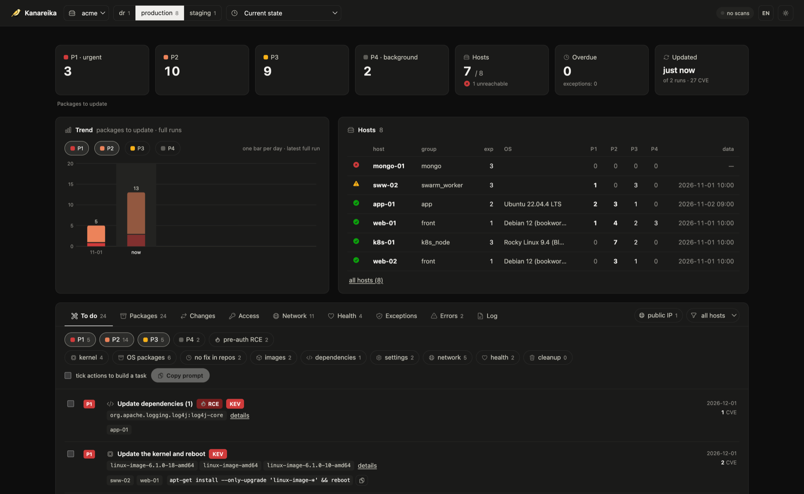

# Kanareika

[](https://github.com/mikekosulin/kanareika/actions/workflows/ci.yml) [](https://github.com/mikekosulin/kanareika/releases/latest) [](LICENSE)

[English](README.md) · **Русский**

Безагентный аудит безопасности серверов по SSH, только чтение: что обновлять первым, кто может войти, что открыто
наружу, здоров ли хост — с готовыми шагами исправления и откатом. Один бинарник, один YAML на организацию, данные
остаются у вас.



```bash
make bin                     # или скачать kanareika-<os>-<arch> из релиза
make new-org ORG=myorg       # описать хосты, бастионы и согласие в orgs/myorg.yml
make feeds && make scan ORG=myorg
make dashboard               # http://127.0.0.1:8088
```

- **Уязвимости** — пакеты ОС, образы, jar/lock-файлы через trivy, встроенный в бинарник (скачиваются только его базы, или импортируются офлайн); бэкпорты и наличие исправления
  проверяются на хосте; приоритеты **P1–P4** по KEV, EPSS, доступности снаружи и pre-auth RCE.
- **Доступ и периметр** — вход по паролю для каждого пользователя, ключи, входы и атакующие, открытые порты,
  файрволы, внешний скан.
- **Здоровье** — ошибки ядра, диски, память, синхронизация времени, ожидающие перезагрузки.
- **Исправление** — отметить действия → готовая задача для инженера или ИИ-агента (apply / verify / rollback); MCP
  для агентов.
- **Безопасно** — только чтение, изоляция организаций, смена ключа хоста не принимается, нужно согласие, dashboard
  только на localhost.

Подробнее: [docs/org-file.md](docs/org-file.md) · `kanareika --help`

Лицензия: [MIT](LICENSE) · [Как участвовать](CONTRIBUTING.md) · [Безопасность](SECURITY.md)
