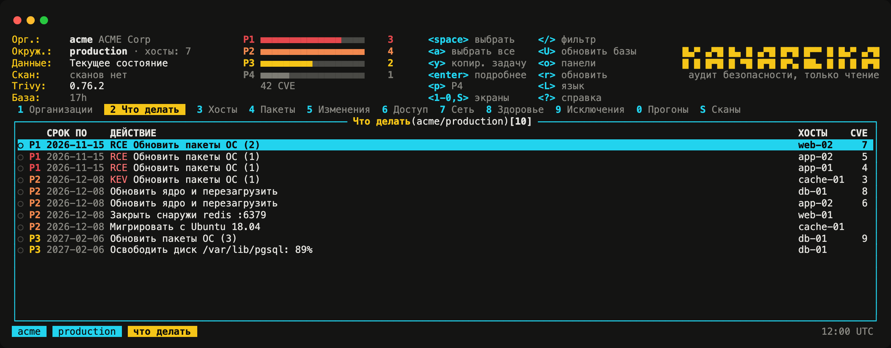
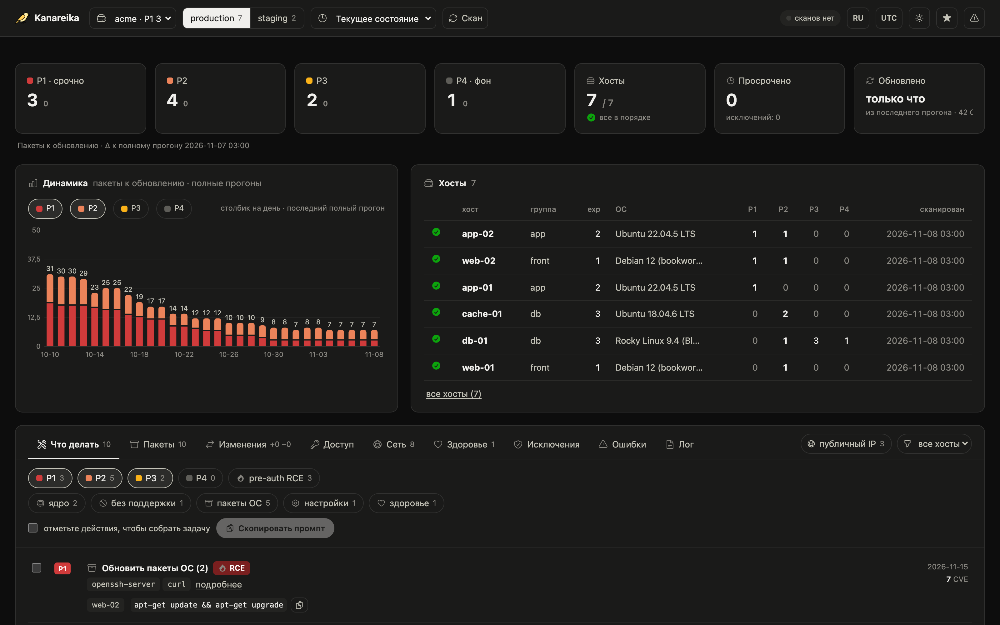

# Kanareika

[](https://github.com/mikekosulin/kanareika/actions/workflows/ci.yml) [](https://github.com/mikekosulin/kanareika/actions/workflows/ci.yml) [](https://github.com/mikekosulin/kanareika/releases/latest) [](LICENSE) [](https://github.com/mikekosulin/kanareika)

[English](README.md) · **Русский** · [中文](README.zh.md)

Безагентный аудит безопасности серверов по SSH, только чтение: что обновлять первым, кто может войти, что торчит
наружу, здоровы ли хосты, — и шаги исправления с откатом. Один бинарник, один YAML на организацию, данные остаются у
вас.

### Интерфейс в терминале

Запустите `kanareika`. Он открывается на списке «Что делать»: самое срочное сверху.



### Веб-интерфейс

Запустите `kanareika web`: те же данные в браузере и динамика за последние 30 прогонов.



<sub>Демо-данные, выдуманные.</sub>

```bash
brew install mikekosulin/tap/kanareika   # macOS, Linux; или бинарник из релиза (и для Windows)
kanareika init                   # orgs/, secrets/, reports/ здесь (или --home DIR)
kanareika org new myorg          # хосты, бастионы и согласие: orgs/myorg.yml
kanareika validate myorg
kanareika db update              # базы уязвимостей (закрытый контур: db export / db import)
kanareika scan myorg
kanareika                        # интерфейс в терминале
kanareika web                    # веб-интерфейс, http://127.0.0.1:8088
```

**Четыре входа, одни данные и правила:**

- **TUI**, основной — `kanareika`: в духе k9s; `?` — клавиши, `o` — панели, `L` — язык. Подключается и к удалённому вебу:
  `kanareika tui --url http://host:8088 --token …`.
- **Веб** — `kanareika web`: сводки, динамика, карточки хостов; сканы запускаются со страницы.
- **Команды** — для скриптов и cron: `kanareika --help`.
- **MCP** — `kanareika mcp`: инструменты только на чтение для ИИ-агентов (Claude Code и другие).

**Что проверяет:**

- **Уязвимости** — пакеты ОС, образы, jar и lock-файлы через trivy, встроенный в бинарник; бэкпорты и наличие
  исправления проверяются на хосте; приоритеты **P1–P4** по KEV, EPSS, доступности снаружи и pre-auth RCE.
- **Доступ и периметр** — вход по паролю, ключи, входы и атакующие, открытые порты, файрволы, внешний скан.
- **Здоровье** — ошибки ядра, диски, память, синхронизация времени, ожидающие перезагрузки.
- **Исправление** — выбранные действия превращаются в готовую задачу для инженера или ИИ-агента: применить,
  проверить, откатить.
- **Безопасно** — только чтение, организации изолированы, смена ключа хоста не принимается, без согласия скана нет,
  веб только на localhost (или с токеном).

Нравится? [Поставьте звезду](https://github.com/mikekosulin/kanareika) · Что-то не так? [Заведите issue](https://github.com/mikekosulin/kanareika/issues/new/choose)
(без реальных хостов и адресов) · Уязвимость? [Сообщите приватно](SECURITY.md)

[Формат файла организации](docs/org-file.md) · [Изменения](CHANGELOG.md) · [Как участвовать](CONTRIBUTING.md) · [MIT](LICENSE)
