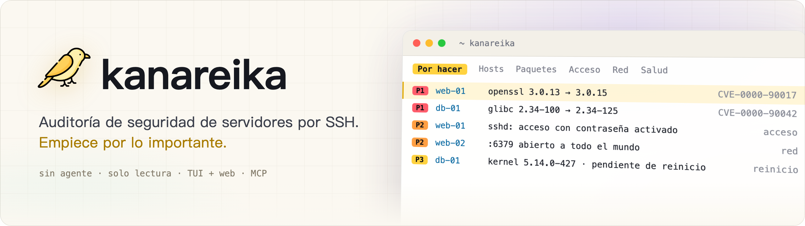
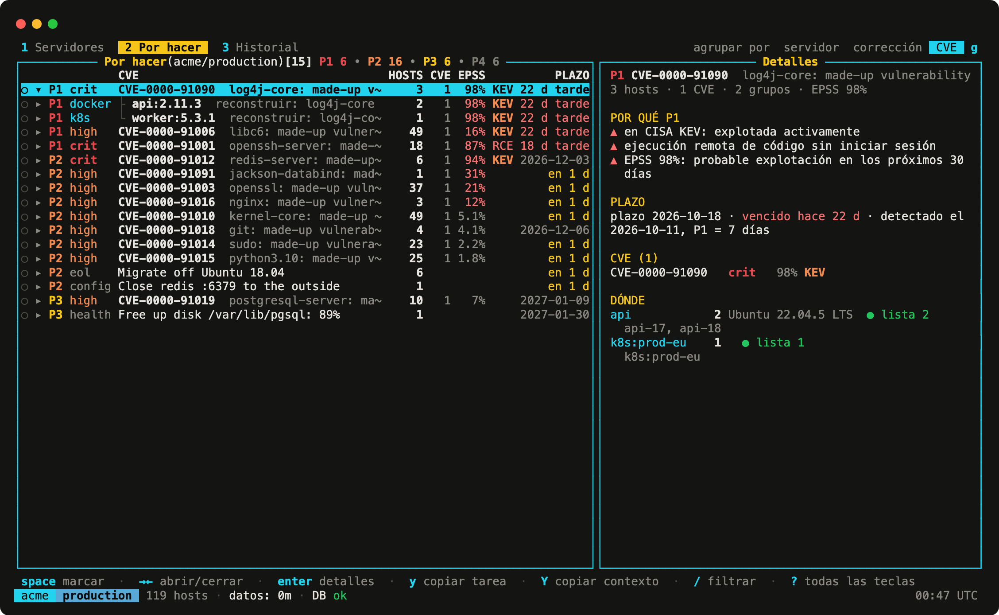
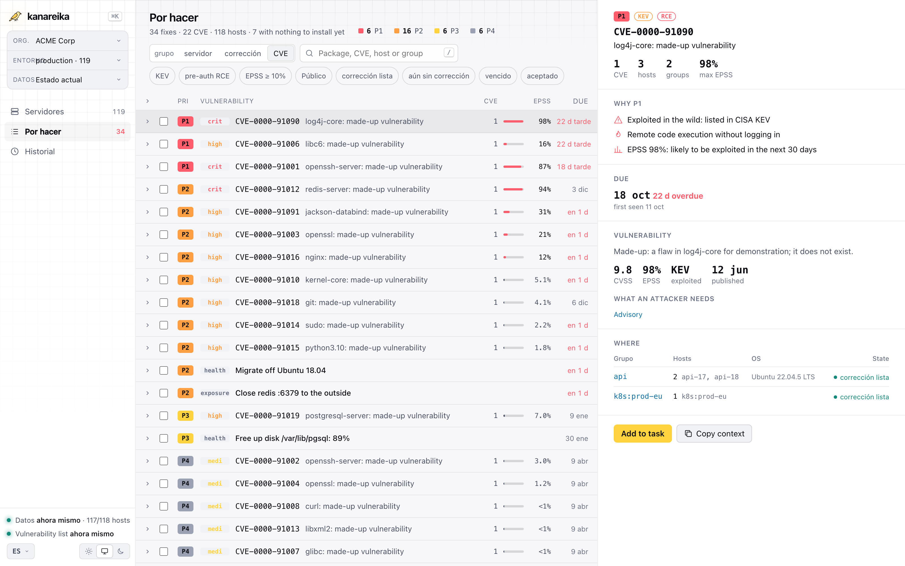

<h1><picture><source media="(prefers-color-scheme: dark)" srcset="../brand/banner-es.png"></picture></h1>

[](https://github.com/mikekosulin/kanareika/actions/workflows/ci.yml) [](https://github.com/mikekosulin/kanareika/actions/workflows/coverage.yml) [](https://github.com/mikekosulin/kanareika/releases/latest) [](../../LICENSE) [](https://github.com/mikekosulin/kanareika)

[English](../../README.md) · **Español** · [Français](README.fr.md) · [Português](README.pt.md) · [Русский](README.ru.md) · [中文](README.zh.md) · [日本語](README.ja.md) · [한국어](README.ko.md)

Auditoría de seguridad de servidores Linux por SSH, sin agentes y de solo lectura. Ordena qué parchear primero: CVE con KEV y EPSS, acceso SSH, puertos expuestos, salud de los hosts, cada uno con pasos de corrección que se pueden revertir. Funciona igual en una interfaz de terminal, en una interfaz web y a través de un servidor MCP para agentes de IA. Un solo binario de Go, un YAML por organización, sin telemetría; los datos no salen de su máquina.

- **Homelab**: elija sus hosts de `~/.ssh/config` o pegue `user@host`.
- **Freelance**: una organización por cliente; añada servidores más adelante.
- **Empresa**: pegue una lista de hosts, un CSV o un inventario de Ansible; los accesos fallidos se agrupan por causa, con la solución.

### Interfaz de terminal

Ejecute `kanareika`. Se abre en «Por hacer»: lo que hay que corregir primero, lo más urgente arriba.



### Interfaz web

Ejecute `kanareika web` para ver los mismos datos en el navegador, con la tendencia de las últimas 30 ejecuciones.

<picture><source media="(prefers-color-scheme: dark)" srcset="../screenshots/web-es.png"></picture>

<sub>Datos de demostración, inventados.</sub>

### Instalación

Homebrew (macOS, Linux); la fórmula fija la versión y su suma de comprobación:

```bash
brew install mikekosulin/tap/kanareika
```

O con el script de instalación: léalo y luego ejecútelo:

```bash
curl -fsSLO https://raw.githubusercontent.com/mikekosulin/kanareika/main/install.sh
less install.sh
sh install.sh
```

Elige la versión para esta máquina, verifica su suma de comprobación (y la atestación de la compilación, si GitHub CLI está instalado) y pregunta antes de instalar en `/usr/local/bin` o `~/.local/bin`; `KANAREIKA_YES=1` omite la pregunta.

O a mano (Linux, macOS):

```bash
OS=$(uname -s | tr '[:upper:]' '[:lower:]')                 # linux, darwin
ARCH=$(uname -m | sed 's/x86_64/amd64/; s/aarch64/arm64/')  # amd64, arm64
FILE=kanareika-$OS-$ARCH.tar.xz
URL=https://github.com/mikekosulin/kanareika/releases/latest/download

curl -fsSLO "$URL/$FILE"
curl -fsSLO "$URL/SHA256SUMS"
sha256sum -c --ignore-missing SHA256SUMS  # macOS: shasum -a 256 -c --ignore-missing SHA256SUMS
gh attestation verify "$FILE" --repo mikekosulin/kanareika  # opcional, requiere GitHub CLI
tar -xJf "$FILE" kanareika
```

`tar` deja `kanareika` en el directorio actual.

Windows (PowerShell):

```powershell
Invoke-WebRequest https://github.com/mikekosulin/kanareika/releases/latest/download/kanareika-windows-amd64.zip -OutFile kanareika.zip; Expand-Archive kanareika.zip -DestinationPath kanareika
```

Luego ejecute `kanareika.exe` desde la carpeta `kanareika`. En ARM, use `kanareika-windows-arm64.zip` en su lugar.

### Inicio

En la terminal:

```bash
kanareika
```

o en el navegador, en http://127.0.0.1:8088 (solo escucha en localhost):

```bash
kanareika web
```

En el primer inicio le guía para añadir sus servidores (usuario y clave SSH, hosts, consentimiento para el escaneo) y ejecuta el primer escaneo; antes de descargar la lista de vulnerabilidades (unos 210 MB) le pregunta.

### Para scripts y cron

Cree una organización; su configuración queda en `orgs/<ORG_ID>.yml`:

```bash
kanareika org new <ORG_ID>
```

Escanéela; antes se comprueba el archivo y se descargan las bases:

```bash
kanareika scan <ORG_ID>
```

La interfaz web en otro puerto (`--port 0` toma cualquiera libre):

```bash
kanareika web --port <PORT>
```

La interfaz de terminal conectada a una web remota:

```bash
kanareika tui --url http://<SERVER>:8088 --token <YOUR_SECRET_TOKEN>
```

Red aislada: exporte las bases en una máquina con acceso a internet,

```bash
kanareika db export <BUNDLE.tar.gz>
```

luego impórtelas en la máquina aislada y escanee sin conexión:

```bash
kanareika db import <BUNDLE.tar.gz>
kanareika scan <ORG_ID> --offline
```

Todo lo demás: `kanareika --help`.

**Cuatro formas de acceso, mismos datos y reglas:**

- **TUI**: `kanareika`; `?` para las teclas, `o` para los paneles, `L` para el idioma. También se conecta a una web remota.
- **Web**: `kanareika web`; paneles, tendencias, fichas de host; los escaneos se lanzan desde la página.
- **Comandos**: para scripts y cron.
- **MCP**: `kanareika mcp`; herramientas de solo lectura para agentes de IA (Claude Code y otros).

**Qué comprueba:**

- **Vulnerabilidades**: paquetes del SO, imágenes, jars y lockfiles mediante trivy, integrado en el binario; backports y disponibilidad de la corrección verificados en el host; prioridades **P1–P4** según KEV, EPSS, exposición y pre-auth RCE.
- **Acceso y exposición**: inicio de sesión SSH con contraseña, claves, accesos y atacantes, puertos abiertos, firewalls, escaneo externo.
- **Salud**: errores del kernel, discos, memoria, sincronización horaria, reinicios pendientes.
- **Corrección**: las acciones seleccionadas se convierten en una tarea lista para un ingeniero o un agente de IA: aplicar, verificar, revertir.
- **Seguro por diseño**: solo lectura, organizaciones aisladas, se rechazan las claves de host cambiadas, ningún escaneo sin consentimiento, la interfaz web solo en localhost (o con token).
- **Privado**: sin telemetría; no envía nada sobre usted ni sobre sus servidores a ningún sitio, y los informes se quedan en su máquina. Solo descarga datos públicos: las bases de vulnerabilidades (ghcr.io, con mirror.gcr.io y public.ecr.aws como alternativas), CISA KEV (cisa.gov), EPSS (FIRST, empiricalsecurity.com) y las bases de IP DB-IP Lite (db-ip.com), con las que las consultas de IP se hacen sin conexión. Incluso la telemetría del trivy integrado está desactivada.

**Aviso legal.** Kanareika informa de lo que encuentra; no promete encontrarlo todo. Las prioridades y los pasos de corrección son recomendaciones: revíselos antes de ejecutar nada en sus hosts. Audite solo los servidores para los que tenga autorización. Se ofrece tal cual, sin garantía ([MIT](../../LICENSE)).

¿Le gusta? [Dele una estrella](https://github.com/mikekosulin/kanareika) · ¿Algo falla? [Abra una incidencia](https://github.com/mikekosulin/kanareika/issues/new/choose) (sin hosts ni direcciones reales, por favor) · ¿Una vulnerabilidad? [Infórmela en privado](../../SECURITY.md)

[Referencia del archivo de organización](../org-file.md) · [Registro de cambios](../../CHANGELOG.md) · [Cómo contribuir](../../CONTRIBUTING.md) · [MIT](../../LICENSE)
