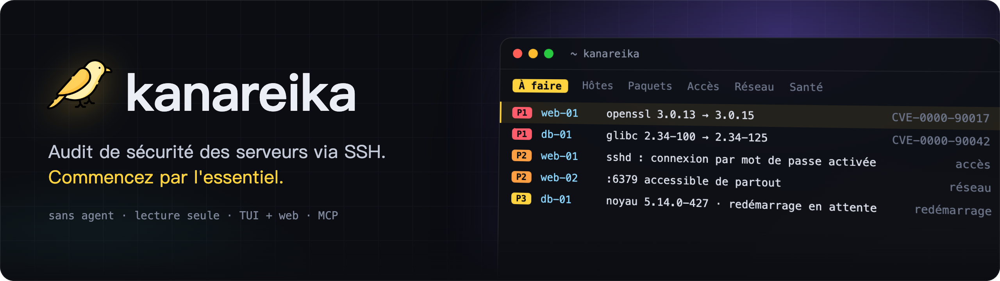
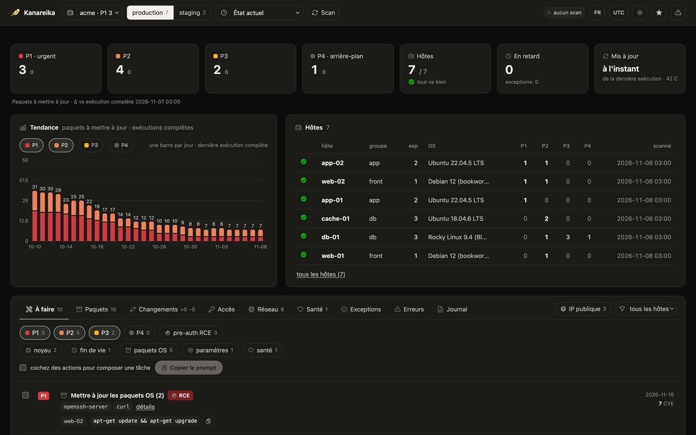

<h1></h1>

[](https://github.com/mikekosulin/kanareika/actions/workflows/ci.yml) [](https://github.com/mikekosulin/kanareika/actions/workflows/coverage.yml) [](https://github.com/mikekosulin/kanareika/releases/latest) [](../../LICENSE) [](https://github.com/mikekosulin/kanareika)

[English](../../README.md) · [Español](README.es.md) · **Français** · [Português](README.pt.md) · [Русский](README.ru.md) · [中文](README.zh.md) · [日本語](README.ja.md) · [한국어](README.ko.md)

Audit de sécurité de vos serveurs via SSH, sans agent et en lecture seule : quoi corriger en premier, qui peut entrer, ce qui est exposé, si les hôtes sont en bonne santé — avec des étapes de correction réversibles. Un seul binaire, un YAML par organisation ; les données restent sur votre machine.

### Interface terminal

Lancez `kanareika`. Il s'ouvre sur « À faire » : ce qu'il faut corriger en premier, le plus urgent en haut.


### Interface web

Lancez `kanareika web` pour retrouver les mêmes données dans un navigateur, avec la tendance des 30 dernières exécutions.



<sub>Données de démo, fictives.</sub>

```bash
brew install mikekosulin/tap/kanareika   # macOS, Linux ; ou un binaire de la release (Windows aussi)
kanareika init                   # orgs/, secrets/, reports/ ici (ou --home DIR)
kanareika org new myorg          # hôtes, hôtes de rebond et consentement : orgs/myorg.yml
kanareika validate myorg
kanareika db update              # bases de vulnérabilités (réseau isolé : db export / db import)
kanareika scan myorg
kanareika                        # interface terminal
kanareika web                    # interface web, http://127.0.0.1:8088
```

**Quatre points d'entrée, mêmes données et mêmes règles :**

- **TUI**, l'interface principale — `kanareika` : `?` pour les raccourcis, `o` pour les panneaux, `L` pour la langue. Peut aussi se connecter à une instance web distante : `kanareika tui --url http://host:8088 --token …`.
- **Web** — `kanareika web` : tableaux de bord, tendances, fiches des hôtes ; les scans se lancent depuis la page.
- **Commandes** — pour les scripts et le cron : `kanareika --help`.
- **MCP** — `kanareika mcp` : outils en lecture seule pour les agents IA (Claude Code et autres).

**Ce qu'il vérifie :**

- **Vulnérabilités** — paquets OS, images, JAR et lockfiles via Trivy intégré au binaire ; backports et disponibilité des correctifs vérifiés sur l'hôte ; priorités **P1–P4** selon KEV, EPSS, l'exposition et les RCE pré-auth.
- **Accès et exposition** — connexion SSH par mot de passe, clés, connexions et attaquants, ports ouverts, pare-feu, scan externe.
- **Santé** — erreurs du noyau, disques, mémoire, synchronisation de l'heure, redémarrages en attente.
- **Correction** — les actions sélectionnées deviennent une tâche prête pour un ingénieur ou un agent IA : appliquer, vérifier, revenir en arrière.
- **Sûr par conception** — lecture seule, organisations isolées, clés d'hôte modifiées refusées, aucun scan sans consentement, interface web sur localhost uniquement (ou avec un jeton).

**Avertissement.** Kanareika signale ce qu'il trouve ; il ne promet pas de tout trouver. Les priorités et les étapes de correction sont des conseils : relisez-les avant d'exécuter quoi que ce soit sur vos hôtes. N'auditez que les serveurs que vous êtes autorisé à auditer. Fourni tel quel, sans garantie ([MIT](../../LICENSE)).

Ça vous plaît ? [Mettez une étoile](https://github.com/mikekosulin/kanareika) · Un problème ? [Ouvrez un ticket](https://github.com/mikekosulin/kanareika/issues/new/choose) (sans vrais hôtes ni adresses, s'il vous plaît) · Une vulnérabilité ? [Signalez-la en privé](../../SECURITY.md)

[Référence du fichier d'organisation](../org-file.md) · [Changelog](../../CHANGELOG.md) · [Contribuer](../../CONTRIBUTING.md) · [MIT](../../LICENSE)
