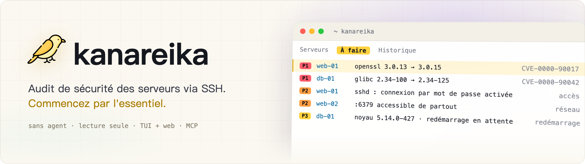
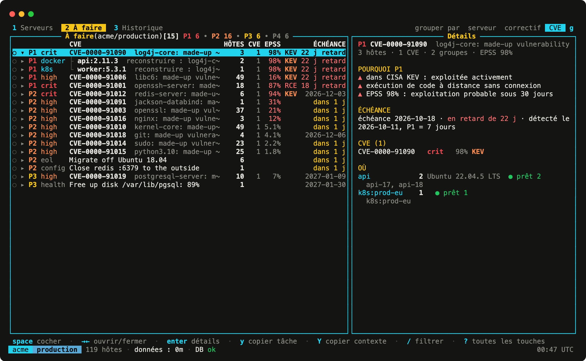
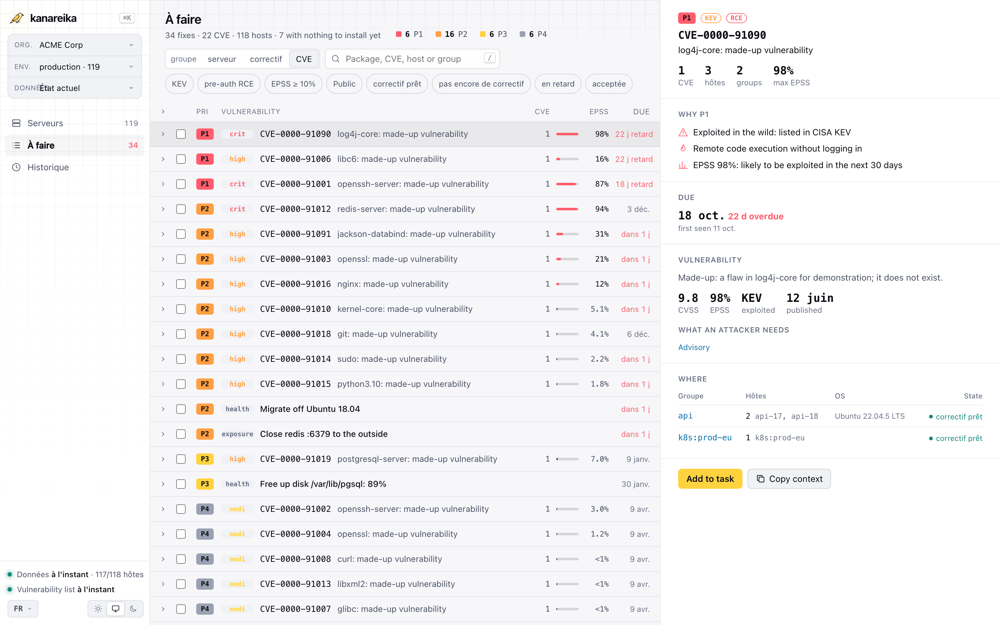

<h1><picture><source media="(prefers-color-scheme: dark)" srcset="../brand/banner-fr.webp"></picture></h1>

[](https://github.com/mikekosulin/kanareika/actions/workflows/ci.yml) [](https://github.com/mikekosulin/kanareika/actions/workflows/coverage.yml) [](https://github.com/mikekosulin/kanareika/releases/latest) [](../../LICENSE) [](https://github.com/mikekosulin/kanareika)

[English](../../README.md) · [Español](README.es.md) · **Français** · [Português](README.pt.md) · [Русский](README.ru.md) · [中文](README.zh.md) · [日本語](README.ja.md) · [한국어](README.ko.md)

Audit de sécurité de serveurs Linux via SSH, sans agent et en lecture seule. Il classe ce qu'il faut corriger en premier : CVE avec KEV et EPSS, accès SSH, ports exposés, santé des hôtes, chacun avec des étapes de correction réversibles. Il fonctionne de la même façon dans une interface en terminal, une interface web et via un serveur MCP pour les agents IA. Un seul binaire Go, un YAML par organisation, aucune télémétrie ; les données restent sur votre machine.

- **Homelab** : choisissez vos hôtes dans `~/.ssh/config` ou collez `user@host`.
- **Freelance** : une organisation par client ; ajoutez-y des serveurs plus tard.
- **Entreprise** : collez une liste d'hôtes, un CSV ou un inventaire Ansible ; les connexions échouées sont regroupées par cause, avec le correctif.

### Interface terminal

Lancez `kanareika`. Il s'ouvre sur « À faire » : ce qu'il faut corriger en premier, le plus urgent en haut.



### Interface web

Lancez `kanareika web` pour retrouver les mêmes données dans un navigateur, avec la tendance des 30 dernières exécutions.

<picture><source media="(prefers-color-scheme: dark)" srcset="../screenshots/web-fr.png"></picture>

<sub>Données de démo, fictives.</sub>

### Installation

Homebrew (macOS, Linux) ; la formule fixe la version et sa somme de contrôle :

```bash
brew install mikekosulin/tap/kanareika
```

Ou avec le script d'installation — lisez-le, puis lancez-le :

```bash
curl -fsSLO https://raw.githubusercontent.com/mikekosulin/kanareika/main/install.sh
less install.sh
sh install.sh
```

Il choisit la version pour cette machine, vérifie sa somme de contrôle (et l'attestation de build si la CLI GitHub est installée) et demande confirmation avant d'installer dans `/usr/local/bin` ou `~/.local/bin` ; `KANAREIKA_YES=1` saute la question.

Ou à la main (Linux, macOS) :

```bash
OS=$(uname -s | tr '[:upper:]' '[:lower:]')                 # linux, darwin
ARCH=$(uname -m | sed 's/x86_64/amd64/; s/aarch64/arm64/')  # amd64, arm64
FILE=kanareika-$OS-$ARCH.tar.xz
URL=https://github.com/mikekosulin/kanareika/releases/latest/download

curl -fsSLO "$URL/$FILE"
curl -fsSLO "$URL/SHA256SUMS"
sha256sum -c --ignore-missing SHA256SUMS  # macOS: shasum -a 256 -c --ignore-missing SHA256SUMS
gh attestation verify "$FILE" --repo mikekosulin/kanareika  # facultatif, nécessite la CLI GitHub
tar -xJf "$FILE" kanareika
```

`tar` dépose `kanareika` dans le répertoire courant.

Windows (PowerShell) :

```powershell
Invoke-WebRequest https://github.com/mikekosulin/kanareika/releases/latest/download/kanareika-windows-amd64.zip -OutFile kanareika.zip; Expand-Archive kanareika.zip -DestinationPath kanareika
```

Lancez ensuite `kanareika.exe` depuis le dossier `kanareika`. Sur ARM, prenez plutôt `kanareika-windows-arm64.zip`.

### Démarrer

Dans le terminal :

```bash
kanareika
```

ou dans le navigateur, sur http://127.0.0.1:8088 (il n'écoute que sur localhost) :

```bash
kanareika web
```

Au premier lancement, il vous guide pour ajouter vos serveurs (utilisateur et clé SSH, hôtes, consentement au scan) et lance le premier scan ; il demande avant de télécharger la liste des vulnérabilités (environ 210 Mo).

### Pour les scripts et cron

Créez une organisation ; ses réglages vont dans `orgs/<ORG_ID>.yml` :

```bash
kanareika org new <ORG_ID>
```

Scannez-la ; le fichier est d'abord vérifié et les bases téléchargées :

```bash
kanareika scan <ORG_ID>
```

L'interface web sur un autre port (`--port 0` prend n'importe quel port libre) :

```bash
kanareika web --port <PORT>
```

L'interface terminal connectée à une instance web distante :

```bash
kanareika tui --url http://<SERVER>:8088 --token <YOUR_SECRET_TOKEN>
```

Réseau isolé : exportez les bases sur une machine qui a accès à internet,

```bash
kanareika db export <BUNDLE.tar.gz>
```

puis importez-les sur la machine isolée et scannez hors ligne :

```bash
kanareika db import <BUNDLE.tar.gz>
kanareika scan <ORG_ID> --offline
```

Tout le reste : `kanareika --help`.

**Quatre points d'entrée, mêmes données et mêmes règles :**

- **TUI** — `kanareika` : `?` pour les raccourcis, `o` pour les panneaux, `L` pour la langue. Peut aussi se connecter à une instance web distante.
- **Web** — `kanareika web` : tableaux de bord, tendances, fiches des hôtes ; les scans se lancent depuis la page.
- **Commandes** — pour les scripts et le cron.
- **MCP** — `kanareika mcp` : outils en lecture seule pour les agents IA (Claude Code et autres).

**Ce qu'il vérifie :**

- **Vulnérabilités** — paquets OS, images, JAR et lockfiles via Trivy intégré au binaire ; backports et disponibilité des correctifs vérifiés sur l'hôte ; priorités **P1–P4** selon KEV, EPSS, l'exposition et les RCE pré-auth.
- **Accès et exposition** — connexion SSH par mot de passe, clés, connexions et attaquants, ports ouverts, pare-feu, scan externe.
- **Santé** — erreurs du noyau, disques, mémoire, synchronisation de l'heure, redémarrages en attente.
- **Correction** — les actions sélectionnées deviennent une tâche prête pour un ingénieur ou un agent IA : appliquer, vérifier, revenir en arrière.
- **Sûr par conception** — lecture seule, organisations isolées, clés d'hôte modifiées refusées, aucun scan sans consentement, interface web sur localhost uniquement (ou avec un jeton).
- **Confidentiel** — aucune télémétrie : rien sur vous ni sur vos serveurs n'est envoyé nulle part, et les rapports restent sur votre machine. Il ne télécharge que des données publiques : les bases de vulnérabilités (ghcr.io, avec mirror.gcr.io et public.ecr.aws en secours), CISA KEV (cisa.gov), EPSS (FIRST, empiricalsecurity.com) et les bases IP DB-IP Lite (db-ip.com), sur lesquelles les recherches d'IP se font hors ligne. Même la télémétrie du trivy intégré est désactivée.

**Avertissement.** Kanareika signale ce qu'il trouve ; il ne promet pas de tout trouver. Les priorités et les étapes de correction sont des conseils : relisez-les avant d'exécuter quoi que ce soit sur vos hôtes. N'auditez que les serveurs que vous êtes autorisé à auditer. Fourni tel quel, sans garantie ([MIT](../../LICENSE)).

Ça vous plaît ? [Mettez une étoile](https://github.com/mikekosulin/kanareika) · Un problème ? [Ouvrez un ticket](https://github.com/mikekosulin/kanareika/issues/new/choose) (sans vrais hôtes ni adresses, s'il vous plaît) · Une vulnérabilité ? [Signalez-la en privé](../../SECURITY.md)

[Référence du fichier d'organisation](../org-file.md) · [Changelog](../../CHANGELOG.md) · [Contribuer](../../CONTRIBUTING.md) · [MIT](../../LICENSE)
