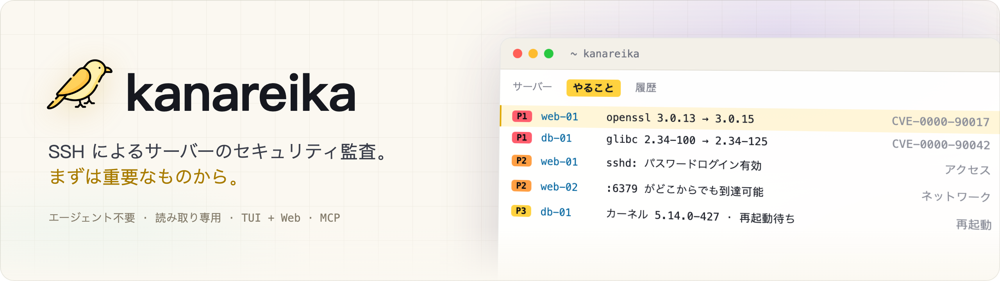
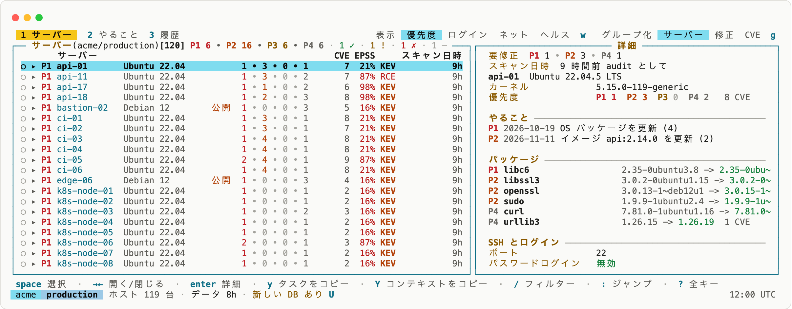
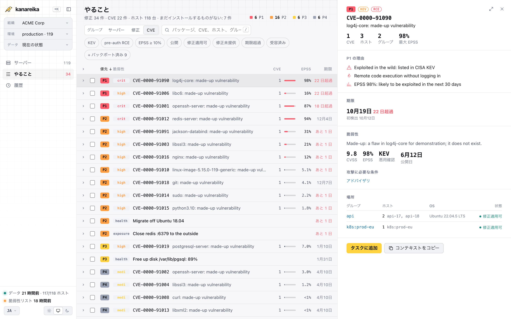

<h1><picture><source media="(prefers-color-scheme: dark)" srcset="../brand/banner-ja.webp"></picture></h1>

[](https://github.com/mikekosulin/kanareika/actions/workflows/ci.yml) [](https://github.com/mikekosulin/kanareika/actions/workflows/coverage.yml) [](https://github.com/mikekosulin/kanareika/releases/latest) [](../../LICENSE) [](https://github.com/mikekosulin/kanareika)

[English](../../README.md) · [Español](README.es.md) · [Français](README.fr.md) · [Português](README.pt.md) · [Русский](README.ru.md) · [中文](README.zh.md) · **日本語** · [한국어](README.ko.md)

エージェント不要・読み取り専用で、SSH 経由で Linux サーバーのセキュリティを監査します。最初にパッチすべきものを順位付けし（KEV と EPSS を加味した CVE、SSH アクセス、公開ポート、ホストの健全性）、それぞれにロールバック可能な修正手順を示します。ターミナル UI、Web UI、AI エージェント向けの MCP サーバーのどれでも同じように使えます。Go のバイナリ 1 つ、組織ごとに YAML 1 つ、テレメトリなし。データは手元のマシンから出ません。

- **自宅ラボ**: `~/.ssh/config` からホストを選ぶか、`user@host` を貼り付けます。
- **フリーランス**: クライアントごとに組織を 1 つ。サーバーは後から追加できます。
- **企業**: ホスト一覧、CSV、Ansible インベントリを貼り付けます。ログインの失敗は原因ごとにまとめられ、対処法が示されます。

### ターミナル UI

`kanareika` を実行すると「やること」画面が開きます。最初に直すべきものが、緊急度の高い順に並びます。

<picture><source media="(prefers-color-scheme: dark)" srcset="../screenshots/tui-ja.webp"></picture>

### Web UI

`kanareika web` を実行すると、同じデータをブラウザで確認できます。直近 30 回の実行の推移も表示されます。

<picture><source media="(prefers-color-scheme: dark)" srcset="../screenshots/web-ja.webp"></picture>

<sub>デモデータ (架空のもの)。</sub>

### インストール

Homebrew (macOS、Linux)。formula がバージョンとチェックサムを固定しています:

```bash
brew install mikekosulin/tap/kanareika
```

またはインストールスクリプトで。まず内容を読んでから実行します:

```bash
curl -fsSLO https://raw.githubusercontent.com/mikekosulin/kanareika/main/install.sh
less install.sh
sh install.sh
```

このマシンに合ったビルドを選び、チェックサム (GitHub CLI があればビルドの attestation も) を検証し、`/usr/local/bin` または `~/.local/bin` にインストールする前に確認します。`KANAREIKA_YES=1` で確認を省略できます。

または手動で (Linux、macOS):

```bash
cd "$(mktemp -d)"
OS=$(uname -s | tr '[:upper:]' '[:lower:]')                 # linux, darwin
ARCH=$(uname -m | sed 's/x86_64/amd64/; s/aarch64/arm64/')  # amd64, arm64
FILE=kanareika-$OS-$ARCH.tar.xz
URL=https://github.com/mikekosulin/kanareika/releases/latest/download

curl -fsSLO "$URL/$FILE"
curl -fsSLO "$URL/SHA256SUMS"
sha256sum -c --ignore-missing SHA256SUMS  # macOS: shasum -a 256 -c --ignore-missing SHA256SUMS
gh attestation verify "$FILE" --repo mikekosulin/kanareika  # 省略可、GitHub CLI が必要
tar -xJf "$FILE" kanareika
sudo install kanareika /usr/local/bin/  # sudo なしなら: install kanareika ~/.local/bin/
```

Windows (PowerShell):

```powershell
Invoke-WebRequest https://github.com/mikekosulin/kanareika/releases/latest/download/kanareika-windows-amd64.zip -OutFile kanareika.zip; Expand-Archive kanareika.zip -DestinationPath kanareika
```

あとは `kanareika` フォルダーの `kanareika.exe` を実行します。ARM 版は `kanareika-windows-arm64.zip` です。

### 起動

ターミナルで:

```bash
kanareika
```

またはブラウザで。http://127.0.0.1:8088 (localhost のみで待ち受けます):

```bash
kanareika web
```

初回起動時は、サーバーの追加 (SSH ユーザーと鍵、ホスト、スキャンへの同意) を案内し、最初のスキャンを実行します。脆弱性リスト (約 210 MB) はダウンロード前に確認します。

### スクリプトや cron 向け

組織を作成します。設定は `orgs/<ORG_ID>.yml` に保存されます:

```bash
kanareika org new <ORG_ID>
```

スキャンします。事前にファイルの検証と DB のダウンロードが行われます:

```bash
kanareika scan <ORG_ID>
```

別のポートで Web UI を起動 (`--port 0` なら空いているポートを自動で使います):

```bash
kanareika web --port <PORT>
```

ターミナル UI をリモートの Web に接続:

```bash
kanareika tui --url http://<SERVER>:8088 --token <YOUR_SECRET_TOKEN>
```

閉域ネットワーク: インターネットに接続できるマシンで DB をエクスポートし、

```bash
kanareika db export <BUNDLE.tar.gz>
```

閉域側のマシンでインポートしてオフラインでスキャンします:

```bash
kanareika db import <BUNDLE.tar.gz>
kanareika scan <ORG_ID> --offline
```

その他すべて: `kanareika --help`

**4 つの入口、同じデータと同じルール:**

- **TUI** — `kanareika`: `?` でキー一覧、`o` でパネル、`L` で言語切り替え。リモートの Web にも接続できます。
- **Web** — `kanareika web`: ダッシュボード、推移、ホストの詳細。スキャンはページから開始できます。
- **コマンド** — スクリプトや cron 向け。
- **MCP** — `kanareika mcp`: AI エージェント (Claude Code など) 向けの読み取り専用ツール。

**チェック内容:**

- **脆弱性** — OS パッケージ、イメージ、jar、ロックファイルをバイナリに組み込まれた trivy で検査。バックポートと修正の有無はホスト上で確認し、KEV、EPSS、外部への露出、pre-auth RCE に基づいて **P1–P4** の優先度を付けます。
- **アクセスと露出** — SSH のパスワードログイン、鍵、ログイン履歴と攻撃元、開いているポート、ファイアウォール、外部スキャン。
- **ヘルス** — カーネルエラー、ディスク、メモリ、時刻同期、保留中の再起動。
- **修正** — 選んだアクションを、エンジニアや AI エージェント向けのそのまま使えるタスクにします: 適用、検証、ロールバック。
- **安全な設計** — 読み取り専用、組織ごとに分離、変更されたホスト鍵は拒否、同意なしにはスキャンしない、Web UI は localhost のみ (またはトークン付き)。
- **プライバシー** — テレメトリなし。あなたやサーバーに関する情報はどこにも送信されず、レポートは手元のマシンに残ります。ダウンロードするのは公開データだけです: 脆弱性 DB (ghcr.io、予備として mirror.gcr.io と public.ecr.aws)、CISA KEV (cisa.gov)、EPSS (FIRST、empiricalsecurity.com)、DB-IP Lite の IP データベース (db-ip.com)。IP の照会はこれを使ってオフラインで行います。組み込みの trivy のテレメトリも無効にしてあります。

**免責事項:** Kanareika は見つけたものを報告しますが、すべてを見つけることは保証しません。優先度と修正手順は助言です。ホスト上で何かを実行する前に必ず確認してください。監査は許可されたサーバーに対してのみ行ってください。現状のまま、無保証で提供されます ([MIT](../../LICENSE))。

気に入りましたか? [スターを付ける](https://github.com/mikekosulin/kanareika) · 問題がありましたか? [issue を作成](https://github.com/mikekosulin/kanareika/issues/new/choose) (実在のホストやアドレスは含めないでください) · 脆弱性ですか? [非公開で報告](../../SECURITY.md)

[組織ファイルのリファレンス](../org-file.md) · [変更履歴](../../CHANGELOG.md) · [コントリビュート](../../CONTRIBUTING.md) · [MIT](../../LICENSE)
