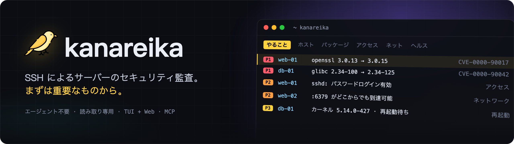
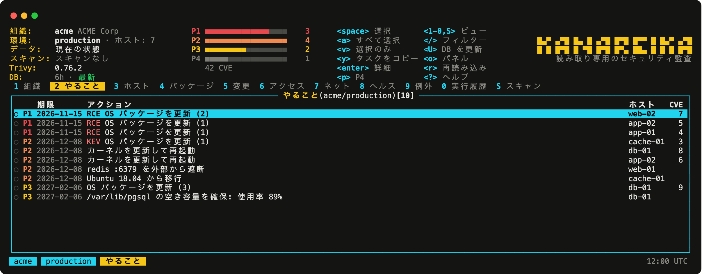
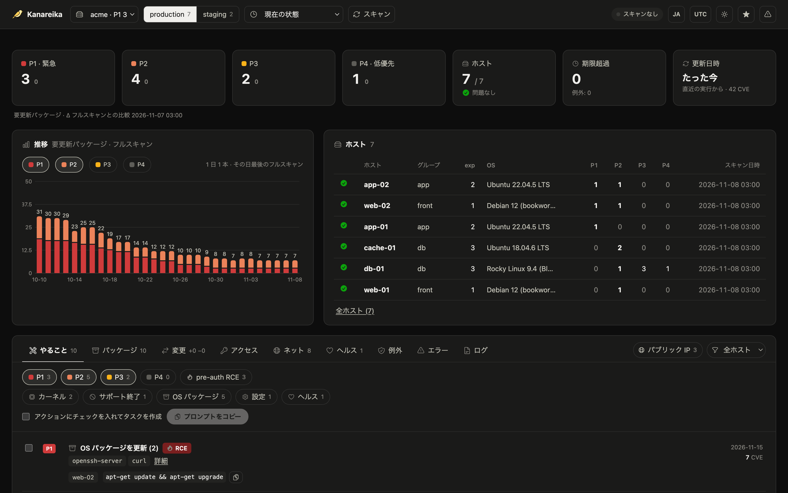

<h1></h1>

[](https://github.com/mikekosulin/kanareika/actions/workflows/ci.yml) [](https://github.com/mikekosulin/kanareika/actions/workflows/coverage.yml) [](https://github.com/mikekosulin/kanareika/releases/latest) [](../../LICENSE) [](https://github.com/mikekosulin/kanareika)

[English](../../README.md) · [Español](README.es.md) · [Français](README.fr.md) · [Português](README.pt.md) · [Русский](README.ru.md) · [中文](README.zh.md) · **日本語** · [한국어](README.ko.md)

エージェント不要・読み取り専用で、SSH 経由でサーバーのセキュリティを監査します。最初にパッチすべきもの、ログインできる人、外部に公開されているもの、ホストの健全性がわかり、ロールバック可能な修正手順も得られます。バイナリ 1 つ、組織ごとに YAML 1 つ。データは手元のマシンから出ません。

### ターミナル UI

`kanareika` を実行すると「やること」画面が開きます。最初に直すべきものが、緊急度の高い順に並びます。



### Web UI

`kanareika web` を実行すると、同じデータをブラウザで確認できます。直近 30 回の実行の推移も表示されます。



<sub>デモデータ (架空のもの)。</sub>

### インストール

Homebrew (macOS、Linux):

```bash
brew install mikekosulin/tap/kanareika
```

Homebrew を使わない Linux: アーキテクチャ (amd64 / arm64) に合ったバイナリをダウンロードし、リリースのチェックサムで検証して `/usr/local/bin` にインストールします:

```bash
arch=$(uname -m | sed 's/x86_64/amd64/;s/aarch64/arm64/')
curl -fsSLO "https://github.com/mikekosulin/kanareika/releases/latest/download/kanareika-linux-$arch"
curl -fsSL https://github.com/mikekosulin/kanareika/releases/latest/download/SHA256SUMS | sha256sum -c --ignore-missing
sudo install -m 755 "kanareika-linux-$arch" /usr/local/bin/kanareika
```

Windows (PowerShell):

```powershell
Invoke-WebRequest https://github.com/mikekosulin/kanareika/releases/latest/download/kanareika-windows-amd64.exe -OutFile kanareika.exe
```

ARM 版は `kanareika-windows-arm64.exe` です。すべてのバイナリは[最新リリース](https://github.com/mikekosulin/kanareika/releases/latest)にあります。

### クイックスタート

1. 作業ディレクトリを作成します。現在のディレクトリに `orgs/`、`secrets/`、`reports/` ができます (別の場所なら `--home DIR`)。

   ```bash
   kanareika init
   ```

2. 組織を追加し、`orgs/myorg.yml` にホスト、踏み台ホスト、スキャンへの同意を記述します。

   ```bash
   kanareika org new myorg
   ```

3. ファイルを検証します。

   ```bash
   kanareika validate myorg
   ```

4. 脆弱性 DB をダウンロードします。閉域ネットワークでは `db export` と `db import` で持ち込みます。

   ```bash
   kanareika db update
   ```

5. スキャンします。

   ```bash
   kanareika scan myorg
   ```

6. 結果をターミナル UI で開きます:

   ```bash
   kanareika
   ```

   または Web UI で開きます。http://127.0.0.1:8088 (localhost のみで待ち受けます):

   ```bash
   kanareika web
   ```

   別のポートは `--port 9000`、`--port 0` なら空いているポートを自動で使います。

**4 つの入口、同じデータと同じルール:**

- **TUI** (メイン) — `kanareika`: `?` でキー一覧、`o` でパネル、`L` で言語切り替え。リモートの Web にも接続できます: `kanareika tui --url http://host:8088 --token …`。
- **Web** — `kanareika web`: ダッシュボード、推移、ホストの詳細。スキャンはページから開始できます。
- **コマンド** — スクリプトや cron 向け: `kanareika --help`。
- **MCP** — `kanareika mcp`: AI エージェント (Claude Code など) 向けの読み取り専用ツール。

**チェック内容:**

- **脆弱性** — OS パッケージ、イメージ、jar、ロックファイルをバイナリに組み込まれた trivy で検査。バックポートと修正の有無はホスト上で確認し、KEV、EPSS、外部への露出、pre-auth RCE に基づいて **P1–P4** の優先度を付けます。
- **アクセスと露出** — SSH のパスワードログイン、鍵、ログイン履歴と攻撃元、開いているポート、ファイアウォール、外部スキャン。
- **ヘルス** — カーネルエラー、ディスク、メモリ、時刻同期、保留中の再起動。
- **修正** — 選んだアクションを、エンジニアや AI エージェント向けのそのまま使えるタスクにします: 適用、検証、ロールバック。
- **安全な設計** — 読み取り専用、組織ごとに分離、変更されたホスト鍵は拒否、同意なしにはスキャンしない、Web UI は localhost のみ (またはトークン付き)。

**免責事項:** Kanareika は見つけたものを報告しますが、すべてを見つけることは保証しません。優先度と修正手順は助言です。ホスト上で何かを実行する前に必ず確認してください。監査は許可されたサーバーに対してのみ行ってください。現状のまま、無保証で提供されます ([MIT](../../LICENSE))。

気に入りましたか? [スターを付ける](https://github.com/mikekosulin/kanareika) · 問題がありましたか? [issue を作成](https://github.com/mikekosulin/kanareika/issues/new/choose) (実在のホストやアドレスは含めないでください) · 脆弱性ですか? [非公開で報告](../../SECURITY.md)

[組織ファイルのリファレンス](../org-file.md) · [変更履歴](../../CHANGELOG.md) · [コントリビュート](../../CONTRIBUTING.md) · [MIT](../../LICENSE)
