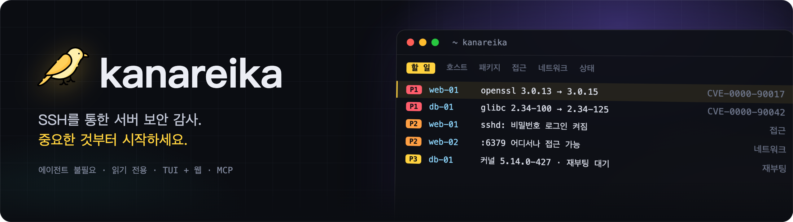
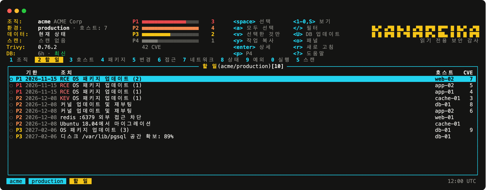
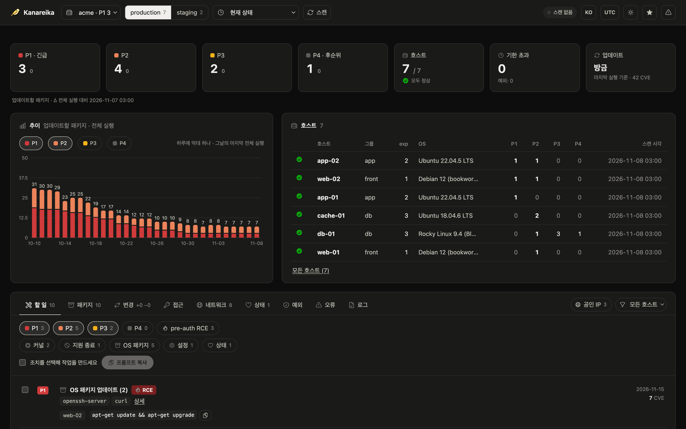

<h1></h1>

[](https://github.com/mikekosulin/kanareika/actions/workflows/ci.yml) [](https://github.com/mikekosulin/kanareika/actions/workflows/coverage.yml) [](https://github.com/mikekosulin/kanareika/releases/latest) [](../../LICENSE) [](https://github.com/mikekosulin/kanareika)

[English](../../README.md) · [Español](README.es.md) · [Français](README.fr.md) · [Português](README.pt.md) · [Русский](README.ru.md) · [中文](README.zh.md) · [日本語](README.ja.md) · **한국어**

에이전트 없이 SSH로 Linux 서버를 점검하는 읽기 전용 보안 감사 도구입니다. KEV와 EPSS를 반영한 CVE, SSH 접근, 노출된 포트, 호스트 상태를 살펴 무엇부터 패치할지 우선순위를 매기고, 항목마다 롤백 가능한 수정 단계를 제시합니다. 터미널 UI, 웹 UI, AI 에이전트용 MCP 서버 어디서나 똑같이 동작합니다. Go 바이너리 하나, 조직마다 YAML 하나, 텔레메트리 없음. 데이터는 내 컴퓨터에만 남습니다.

- **홈랩**: `~/.ssh/config`에서 호스트를 고르거나 `user@host`를 붙여 넣습니다.
- **프리랜서**: 고객마다 조직 하나, 서버는 나중에 추가할 수 있습니다.
- **회사**: 호스트 목록, CSV, Ansible 인벤토리를 붙여 넣습니다. 로그인 실패는 원인별로 묶여 해결 방법과 함께 표시됩니다.

### 터미널 인터페이스

`kanareika`를 실행하면 **할 일** 화면이 열립니다. 먼저 고칠 항목이 나오고, 가장 긴급한 항목이 맨 위에 있습니다.



### 웹 인터페이스

`kanareika web`을 실행하면 같은 데이터를 브라우저에서 최근 30회 실행 추이와 함께 볼 수 있습니다.



<sub>데모 데이터(가상).</sub>

### 설치

Homebrew (macOS, Linux). formula가 버전과 체크섬을 고정합니다:

```bash
brew install mikekosulin/tap/kanareika
```

또는 설치 스크립트로. 먼저 읽어 본 다음 실행합니다:

```bash
curl -fsSLO https://raw.githubusercontent.com/mikekosulin/kanareika/main/install.sh
less install.sh
sh install.sh
```

이 머신에 맞는 빌드를 골라 체크섬(GitHub CLI가 있으면 빌드 attestation도)을 검증하고, `/usr/local/bin` 또는 `~/.local/bin`에 설치하기 전에 묻습니다. `KANAREIKA_YES=1`이면 묻지 않습니다.

또는 직접 (Linux, macOS):

```bash
OS=$(uname -s | tr '[:upper:]' '[:lower:]')                 # linux, darwin
ARCH=$(uname -m | sed 's/x86_64/amd64/; s/aarch64/arm64/')  # amd64, arm64
FILE=kanareika-$OS-$ARCH.tar.xz
URL=https://github.com/mikekosulin/kanareika/releases/latest/download

curl -fsSLO "$URL/$FILE"
curl -fsSLO "$URL/SHA256SUMS"
sha256sum -c --ignore-missing SHA256SUMS  # macOS: shasum -a 256 -c --ignore-missing SHA256SUMS
gh attestation verify "$FILE" --repo mikekosulin/kanareika  # 선택 사항, GitHub CLI 필요
tar -xJf "$FILE" kanareika
```

`tar`는 `kanareika`를 현재 디렉터리에 풉니다.

Windows (PowerShell):

```powershell
Invoke-WebRequest https://github.com/mikekosulin/kanareika/releases/latest/download/kanareika-windows-amd64.zip -OutFile kanareika.zip; Expand-Archive kanareika.zip -DestinationPath kanareika
```

그런 다음 `kanareika` 폴더에서 `kanareika.exe`를 실행합니다. ARM용은 `kanareika-windows-arm64.zip`입니다.

### 시작

터미널에서:

```bash
kanareika
```

또는 브라우저에서. 주소는 http://127.0.0.1:8088이며 localhost에서만 수신합니다:

```bash
kanareika web
```

처음 실행하면 서버 추가(SSH 사용자와 키, 호스트, 스캔 동의)를 안내하고 첫 스캔을 실행합니다. 취약점 목록(약 210MB)은 내려받기 전에 묻습니다.

### 스크립트와 cron용

조직을 만듭니다. 설정은 `orgs/<ORG_ID>.yml`에 저장됩니다:

```bash
kanareika org new <ORG_ID>
```

스캔합니다. 먼저 파일을 검증하고 DB를 내려받습니다:

```bash
kanareika scan <ORG_ID>
```

다른 포트로 웹 인터페이스 실행(`--port 0`이면 빈 포트를 자동으로 고릅니다):

```bash
kanareika web --port <PORT>
```

터미널 인터페이스를 원격 웹 서버에 연결:

```bash
kanareika tui --url http://<SERVER>:8088 --token <YOUR_SECRET_TOKEN>
```

폐쇄망: 인터넷이 되는 머신에서 DB를 내보내고,

```bash
kanareika db export <BUNDLE.tar.gz>
```

폐쇄망 머신에서 가져온 뒤 오프라인으로 스캔합니다:

```bash
kanareika db import <BUNDLE.tar.gz>
kanareika scan <ORG_ID> --offline
```

그 밖의 모든 것: `kanareika --help`.

**네 가지 사용 방식, 같은 데이터와 규칙:**

- **TUI** — `kanareika`: `?` 키 목록, `o` 패널, `L` 언어. 원격 웹 서버에도 연결할 수 있습니다.
- **웹** — `kanareika web`: 대시보드, 추이, 호스트 상세; 스캔은 페이지에서 시작합니다.
- **CLI 명령** — 스크립트와 cron용.
- **MCP** — `kanareika mcp`: AI 에이전트(Claude Code 등)를 위한 읽기 전용 도구.

**점검 항목:**

- **취약점** — 바이너리에 내장된 trivy로 OS 패키지, 이미지, jar, lockfile을 검사; 백포트와 수정 버전 제공 여부는 호스트에서 확인; KEV, EPSS, 외부 노출, pre-auth RCE를 기준으로 **P1–P4** 우선순위 지정.
- **접근과 노출** — SSH 비밀번호 로그인, 키, 로그인 기록과 공격자, 열린 포트, 방화벽, 외부 스캔.
- **상태** — 커널 오류, 디스크, 메모리, 시간 동기화, 대기 중인 재부팅.
- **수정** — 선택한 조치가 엔지니어나 AI 에이전트를 위한 작업으로 바로 만들어집니다: 적용, 확인, 롤백.
- **안전한 설계** — 읽기 전용, 조직 간 격리, 변경된 호스트 키 거부, 동의 없이는 스캔하지 않음, 웹 인터페이스는 localhost 전용 (또는 토큰 사용).
- **프라이버시** — 텔레메트리 없음: 사용자나 서버에 관한 정보를 어디에도 보내지 않으며, 보고서는 내 머신에만 남습니다. 내려받는 것은 공개 데이터뿐입니다: 취약점 DB(ghcr.io, 예비로 mirror.gcr.io와 public.ecr.aws), CISA KEV(cisa.gov), EPSS(FIRST, empiricalsecurity.com), DB-IP Lite IP 데이터베이스(db-ip.com)이며, IP 조회는 이를 이용해 오프라인으로 합니다. 내장된 trivy의 텔레메트리도 꺼져 있습니다.

**면책 조항.** Kanareika는 찾은 것을 보고할 뿐, 모든 것을 찾아낸다고 보장하지 않습니다. 우선순위와 수정 단계는 권고 사항이므로 호스트에서 무엇이든 실행하기 전에 검토하세요. 감사 권한이 있는 서버만 점검하세요. 어떠한 보증도 없이 "있는 그대로" 제공됩니다 ([MIT](../../LICENSE)).

마음에 드세요? [별 누르기](https://github.com/mikekosulin/kanareika) · 문제가 있나요? [이슈 등록](https://github.com/mikekosulin/kanareika/issues/new/choose) (실제 호스트나 주소는 넣지 마세요) · 취약점인가요? [비공개로 제보](../../SECURITY.md)

[조직 파일 레퍼런스](../org-file.md) · [변경 이력](../../CHANGELOG.md) · [기여 방법](../../CONTRIBUTING.md) · [MIT](../../LICENSE)
