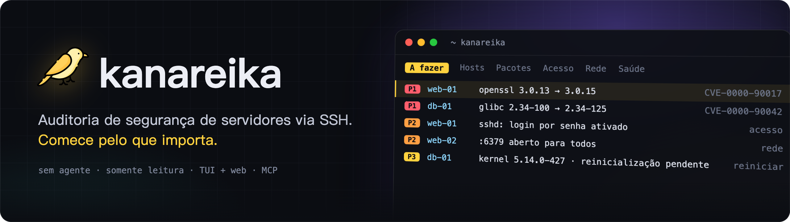
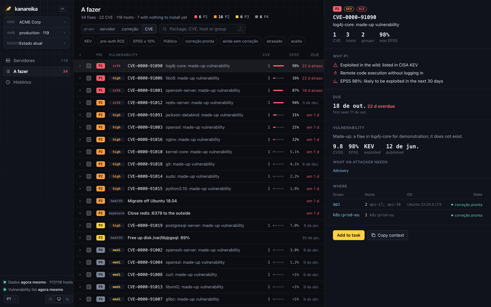

<h1></h1>

[](https://github.com/mikekosulin/kanareika/actions/workflows/ci.yml) [](https://github.com/mikekosulin/kanareika/actions/workflows/coverage.yml) [](https://github.com/mikekosulin/kanareika/releases/latest) [](../../LICENSE) [](https://github.com/mikekosulin/kanareika)

[English](../../README.md) · [Español](README.es.md) · [Français](README.fr.md) · **Português** · [Русский](README.ru.md) · [中文](README.zh.md) · [日本語](README.ja.md) · [한국어](README.ko.md)

Auditoria de segurança dos seus servidores via SSH, sem agente e somente leitura: o que atualizar primeiro, quem consegue entrar, o que está exposto, se os hosts estão saudáveis — com etapas de correção que podem ser revertidas. Um único binário, um YAML por organização; os dados ficam na sua máquina.

### Interface no terminal

Execute `kanareika`. Ele abre na lista “A fazer”: o que corrigir primeiro, o mais urgente no topo.


### Interface web

Execute `kanareika web` para ver os mesmos dados no navegador, com a tendência das últimas 30 execuções.



<sub>Dados de demonstração, fictícios.</sub>

### Instalação

Homebrew (macOS, Linux):

```bash
brew install mikekosulin/tap/kanareika
```

Linux sem Homebrew: baixa o binário da sua arquitetura (amd64 ou arm64), confere-o com as somas de verificação da release e o instala em `/usr/local/bin`:

```bash
arch=$(uname -m | sed 's/x86_64/amd64/;s/aarch64/arm64/')
curl -fsSLO "https://github.com/mikekosulin/kanareika/releases/latest/download/kanareika-linux-$arch"
curl -fsSL https://github.com/mikekosulin/kanareika/releases/latest/download/SHA256SUMS | sha256sum -c --ignore-missing
sudo install -m 755 "kanareika-linux-$arch" /usr/local/bin/kanareika
```

Windows (PowerShell):

```powershell
Invoke-WebRequest https://github.com/mikekosulin/kanareika/releases/latest/download/kanareika-windows-amd64.exe -OutFile kanareika.exe
```

Em ARM, baixe `kanareika-windows-arm64.exe`. Todos os binários estão na [última release](https://github.com/mikekosulin/kanareika/releases/latest).

### Início rápido

1. Crie o diretório de trabalho: `orgs/`, `secrets/` e `reports/` aparecem no diretório atual (ou em outro, com `--home DIR`).

   ```bash
   kanareika init
   ```

2. Adicione uma organização e descreva em `orgs/myorg.yml` os hosts, os jump hosts e o consentimento para o scan.

   ```bash
   kanareika org new myorg
   ```

3. Verifique o arquivo.

   ```bash
   kanareika validate myorg
   ```

4. Baixe as bases de vulnerabilidades. Em uma rede isolada, leve-as com `db export` e `db import`.

   ```bash
   kanareika db update
   ```

5. Execute o scan.

   ```bash
   kanareika scan myorg
   ```

6. Abra os resultados na interface no terminal:

   ```bash
   kanareika
   ```

   ou na interface web, em http://127.0.0.1:8088 (ela escuta apenas em localhost):

   ```bash
   kanareika web
   ```

   Outra porta: `--port 9000`; `--port 0` usa qualquer porta livre.

**Quatro formas de acesso, os mesmos dados e regras:**

- **TUI**, a principal — `kanareika`: `?` para os atalhos, `o` para os painéis, `L` para o idioma. Também se conecta a uma interface web remota: `kanareika tui --url http://host:8088 --token …`.
- **Web** — `kanareika web`: dashboards, tendências, detalhes dos hosts; os scans são iniciados pela página.
- **Comandos** — para scripts e cron: `kanareika --help`.
- **MCP** — `kanareika mcp`: ferramentas somente leitura para agentes de IA (Claude Code e outros).

**O que ele verifica:**

- **Vulnerabilidades** — pacotes do SO, imagens, jars e lockfiles com o trivy embutido no binário; backports e disponibilidade de correção verificados no próprio host; prioridades **P1–P4** por KEV, EPSS, exposição e RCE sem autenticação (pre-auth RCE).
- **Acesso e exposição** — login SSH por senha, chaves, logins e atacantes, portas abertas, firewalls, scan externo.
- **Saúde** — erros do kernel, discos, memória, sincronização de horário, reinicializações pendentes.
- **Correção** — as ações selecionadas viram uma tarefa pronta para um engenheiro ou um agente de IA: aplicar, verificar, reverter.
- **Seguro por design** — somente leitura, organizações isoladas, chaves de host alteradas são recusadas, nenhum scan sem consentimento, a interface web só em localhost (ou com token).

**Aviso.** O Kanareika relata o que encontra; não promete encontrar tudo. Prioridades e etapas de correção são recomendações: revise-as antes de executar qualquer coisa nos seus hosts. Audite apenas servidores que você tem autorização para auditar. Fornecido “como está”, sem garantias ([MIT](../../LICENSE)).

Gostou? [Dê uma estrela](https://github.com/mikekosulin/kanareika) · Algo errado? [Abra uma issue](https://github.com/mikekosulin/kanareika/issues/new/choose) (sem hosts ou endereços reais, por favor) · Vulnerabilidade? [Reporte de forma privada](../../SECURITY.md)

[Referência do arquivo da organização](../org-file.md) · [Changelog](../../CHANGELOG.md) · [Como contribuir](../../CONTRIBUTING.md) · [MIT](../../LICENSE)
