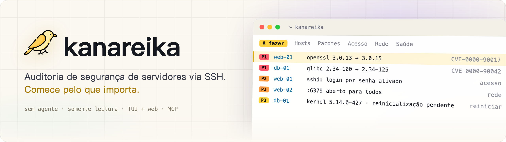
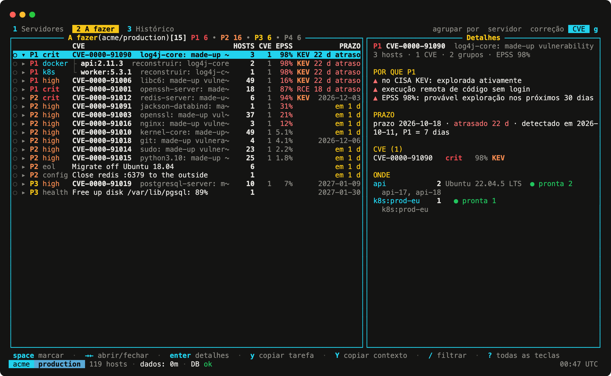
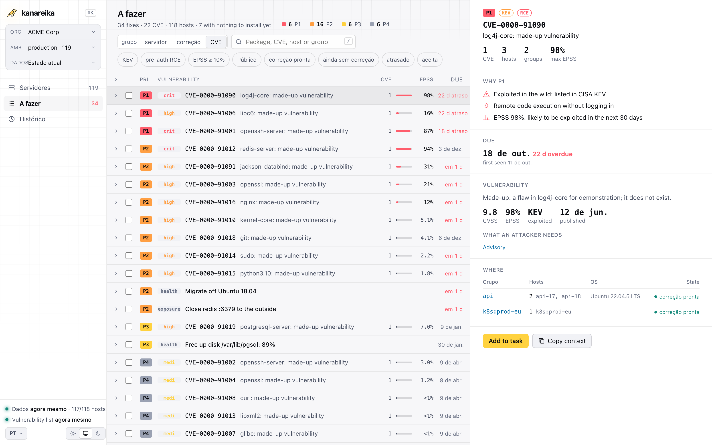

<h1><picture><source media="(prefers-color-scheme: dark)" srcset="../brand/banner-pt.png"></picture></h1>

[](https://github.com/mikekosulin/kanareika/actions/workflows/ci.yml) [](https://github.com/mikekosulin/kanareika/actions/workflows/coverage.yml) [](https://github.com/mikekosulin/kanareika/releases/latest) [](../../LICENSE) [](https://github.com/mikekosulin/kanareika)

[English](../../README.md) · [Español](README.es.md) · [Français](README.fr.md) · **Português** · [Русский](README.ru.md) · [中文](README.zh.md) · [日本語](README.ja.md) · [한국어](README.ko.md)

Auditoria de segurança de servidores Linux via SSH, sem agente e somente leitura. Ordena o que corrigir primeiro: CVEs com KEV e EPSS, acesso SSH, portas expostas, saúde dos hosts, cada um com etapas de correção que podem ser revertidas. Funciona do mesmo jeito em uma interface de terminal, em uma interface web e por um servidor MCP para agentes de IA. Um único binário Go, um YAML por organização, sem telemetria; os dados ficam na sua máquina.

- **Homelab**: escolha seus hosts no `~/.ssh/config` ou cole `user@host`.
- **Freelancer**: uma organização por cliente; adicione servidores depois.
- **Empresa**: cole uma lista de hosts, um CSV ou um inventário do Ansible; as falhas de login são agrupadas por causa, com a correção.

### Interface no terminal

Execute `kanareika`. Ele abre na lista “A fazer”: o que corrigir primeiro, o mais urgente no topo.



### Interface web

Execute `kanareika web` para ver os mesmos dados no navegador, com a tendência das últimas 30 execuções.

<picture><source media="(prefers-color-scheme: dark)" srcset="../screenshots/web-pt.png"></picture>

<sub>Dados de demonstração, fictícios.</sub>

### Instalação

Homebrew (macOS, Linux); a fórmula fixa a versão e a soma de verificação:

```bash
brew install mikekosulin/tap/kanareika
```

Ou com o script de instalação — leia-o e depois execute-o:

```bash
curl -fsSLO https://raw.githubusercontent.com/mikekosulin/kanareika/main/install.sh
less install.sh
sh install.sh
```

Ele escolhe a versão para esta máquina, confere a soma de verificação (e a atestação do build, se o GitHub CLI estiver instalado) e pergunta antes de instalar em `/usr/local/bin` ou `~/.local/bin`; `KANAREIKA_YES=1` pula a pergunta.

Ou manualmente (Linux, macOS):

```bash
OS=$(uname -s | tr '[:upper:]' '[:lower:]')                 # linux, darwin
ARCH=$(uname -m | sed 's/x86_64/amd64/; s/aarch64/arm64/')  # amd64, arm64
FILE=kanareika-$OS-$ARCH.tar.xz
URL=https://github.com/mikekosulin/kanareika/releases/latest/download

curl -fsSLO "$URL/$FILE"
curl -fsSLO "$URL/SHA256SUMS"
sha256sum -c --ignore-missing SHA256SUMS  # macOS: shasum -a 256 -c --ignore-missing SHA256SUMS
gh attestation verify "$FILE" --repo mikekosulin/kanareika  # opcional, requer o GitHub CLI
tar -xJf "$FILE" kanareika
```

`tar` deixa `kanareika` no diretório atual.

Windows (PowerShell):

```powershell
Invoke-WebRequest https://github.com/mikekosulin/kanareika/releases/latest/download/kanareika-windows-amd64.zip -OutFile kanareika.zip; Expand-Archive kanareika.zip -DestinationPath kanareika
```

Depois execute `kanareika.exe` a partir da pasta `kanareika`. Em ARM, use `kanareika-windows-arm64.zip`.

### Início

No terminal:

```bash
kanareika
```

ou no navegador, em http://127.0.0.1:8088 (escuta apenas em localhost):

```bash
kanareika web
```

Na primeira execução, ele guia você para adicionar seus servidores (usuário e chave SSH, hosts, consentimento para o scan) e executa o primeiro scan; pergunta antes de baixar a lista de vulnerabilidades (cerca de 210 MB).

### Para scripts e cron

Crie uma organização; as configurações ficam em `orgs/<ORG_ID>.yml`:

```bash
kanareika org new <ORG_ID>
```

Faça o scan; antes o arquivo é verificado e as bases são baixadas:

```bash
kanareika scan <ORG_ID>
```

A interface web em outra porta (`--port 0` usa qualquer porta livre):

```bash
kanareika web --port <PORT>
```

A interface no terminal conectada a uma interface web remota:

```bash
kanareika tui --url http://<SERVER>:8088 --token <YOUR_SECRET_TOKEN>
```

Rede isolada: exporte as bases em uma máquina com acesso à internet,

```bash
kanareika db export <BUNDLE.tar.gz>
```

depois importe-as na máquina isolada e faça o scan offline:

```bash
kanareika db import <BUNDLE.tar.gz>
kanareika scan <ORG_ID> --offline
```

Todo o resto: `kanareika --help`.

**Quatro formas de acesso, os mesmos dados e regras:**

- **TUI** — `kanareika`: `?` para os atalhos, `o` para os painéis, `L` para o idioma. Também se conecta a uma interface web remota.
- **Web** — `kanareika web`: dashboards, tendências, detalhes dos hosts; os scans são iniciados pela página.
- **Comandos** — para scripts e cron.
- **MCP** — `kanareika mcp`: ferramentas somente leitura para agentes de IA (Claude Code e outros).

**O que ele verifica:**

- **Vulnerabilidades** — pacotes do SO, imagens, jars e lockfiles com o trivy embutido no binário; backports e disponibilidade de correção verificados no próprio host; prioridades **P1–P4** por KEV, EPSS, exposição e RCE sem autenticação (pre-auth RCE).
- **Acesso e exposição** — login SSH por senha, chaves, logins e atacantes, portas abertas, firewalls, scan externo.
- **Saúde** — erros do kernel, discos, memória, sincronização de horário, reinicializações pendentes.
- **Correção** — as ações selecionadas viram uma tarefa pronta para um engenheiro ou um agente de IA: aplicar, verificar, reverter.
- **Seguro por design** — somente leitura, organizações isoladas, chaves de host alteradas são recusadas, nenhum scan sem consentimento, a interface web só em localhost (ou com token).
- **Privado** — sem telemetria: nada sobre você ou seus servidores é enviado a lugar nenhum, e os relatórios ficam na sua máquina. Ele só baixa dados públicos: as bases de vulnerabilidades (ghcr.io, com mirror.gcr.io e public.ecr.aws como alternativas), CISA KEV (cisa.gov), EPSS (FIRST, empiricalsecurity.com) e as bases de IP DB-IP Lite (db-ip.com), nas quais as consultas de IP são feitas offline. Até a telemetria do trivy embutido está desligada.

**Aviso.** O Kanareika relata o que encontra; não promete encontrar tudo. Prioridades e etapas de correção são recomendações: revise-as antes de executar qualquer coisa nos seus hosts. Audite apenas servidores que você tem autorização para auditar. Fornecido “como está”, sem garantias ([MIT](../../LICENSE)).

Gostou? [Dê uma estrela](https://github.com/mikekosulin/kanareika) · Algo errado? [Abra uma issue](https://github.com/mikekosulin/kanareika/issues/new/choose) (sem hosts ou endereços reais, por favor) · Vulnerabilidade? [Reporte de forma privada](../../SECURITY.md)

[Referência do arquivo da organização](../org-file.md) · [Changelog](../../CHANGELOG.md) · [Como contribuir](../../CONTRIBUTING.md) · [MIT](../../LICENSE)
