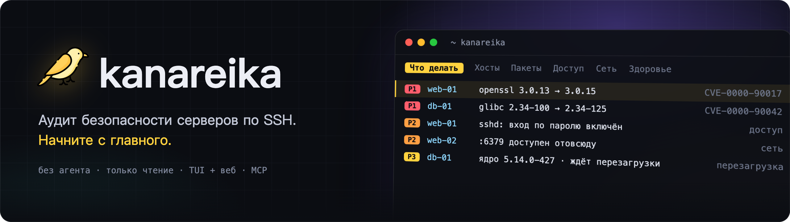
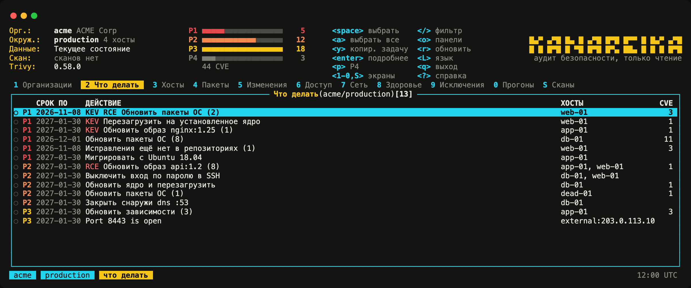
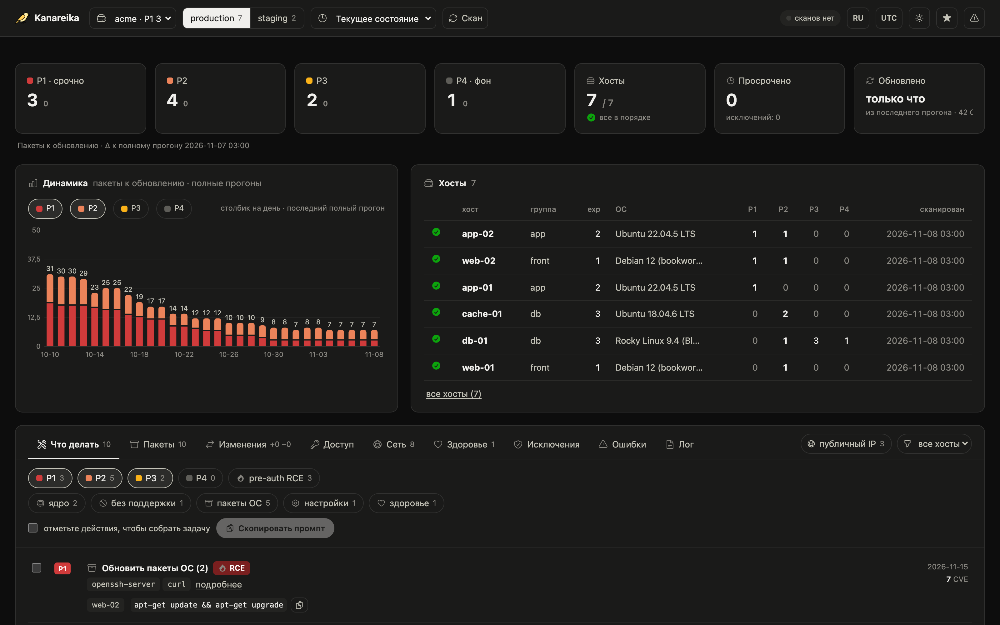

<h1></h1>

[](https://github.com/mikekosulin/kanareika/actions/workflows/ci.yml) [](https://github.com/mikekosulin/kanareika/actions/workflows/coverage.yml) [](https://github.com/mikekosulin/kanareika/releases/latest) [](../../LICENSE) [](https://github.com/mikekosulin/kanareika)

[English](../../README.md) · [Español](README.es.md) · [Français](README.fr.md) · [Português](README.pt.md) · **Русский** · [中文](README.zh.md) · [日本語](README.ja.md) · [한국어](README.ko.md)

Kanareika проверяет безопасность Linux-серверов по SSH. Ставить агент не нужно, на серверах ничего не меняется. Она покажет, какие уязвимости закрывать первыми, кто может зайти на сервер, что открыто наружу и всё ли в порядке с самими хостами. Для каждой проблемы есть готовые шаги исправления с откатом.

Всё в одном бинарнике, настройки организации — в одном YAML-файле, данные хранятся только у вас.

### Терминальный интерфейс

Запустите `kanareika` — откроется список задач, самое срочное сверху.



### Веб-интерфейс

`kanareika web` показывает те же данные в браузере, плюс динамику за последние 30 сканирований.



<sub>На скриншотах вымышленные данные.</sub>

### Установка

Linux, macOS — скрипт выберет сборку под эту машину, сверит контрольную сумму и установит в `/usr/local/bin` (или `~/.local/bin`):

```bash
curl -fsSL https://raw.githubusercontent.com/mikekosulin/kanareika/main/install.sh | sh
```

Homebrew (macOS и Linux):

```bash
brew install mikekosulin/tap/kanareika
```

Windows (PowerShell):

```powershell
Invoke-WebRequest https://github.com/mikekosulin/kanareika/releases/latest/download/kanareika-windows-amd64.zip -OutFile kanareika.zip; Expand-Archive kanareika.zip -DestinationPath kanareika
```

Затем запустите `kanareika.exe` из папки `kanareika`. Для ARM есть отдельный `kanareika-windows-arm64.zip`.

### Запуск

В терминале:

```bash
kanareika
```

или в браузере, на http://127.0.0.1:8088 (веб-интерфейс слушает только localhost):

```bash
kanareika web
```

При первом запуске Kanareika поможет добавить серверы (SSH-пользователь и ключ, хосты, согласие на сканирование) и запустит первое сканирование. Базы уязвимостей скачаются сами.

### Для скриптов и cron

Создать организацию — настройки окажутся в `orgs/<ORG_ID>.yml`:

```bash
kanareika org new <ORG_ID>
```

Просканировать её; перед этим проверяются настройки и скачиваются базы:

```bash
kanareika scan <ORG_ID>
```

Веб-интерфейс на другом порту (`--port 0` — любой свободный):

```bash
kanareika web --port <PORT>
```

Подключить терминальный интерфейс к удалённому веб-интерфейсу:

```bash
kanareika tui --url http://<SERVER>:8088 --token <YOUR_SECRET_TOKEN>
```

Без интернета: выгрузите базы на машине, где интернет есть,

```bash
kanareika db export <BUNDLE.tar.gz>
```

затем загрузите их на изолированной машине и сканируйте офлайн:

```bash
kanareika db import <BUNDLE.tar.gz>
kanareika scan <ORG_ID> --offline
```

Всё остальное — `kanareika --help`.

### Как пользоваться

- **Терминал** — `kanareika`, основной интерфейс. `?` — горячие клавиши, `o` — настройка панелей, `L` — язык. Можно подключиться к удалённому серверу: `kanareika tui --url http://<SERVER>:8088 --token <YOUR_SECRET_TOKEN>`.
- **Браузер** — `kanareika web`: сводка, графики, карточки хостов, сканирование запускается прямо со страницы.
- **Командная строка** — для скриптов и cron, список команд: `kanareika --help`.
- **MCP** — `kanareika mcp`: инструменты только на чтение, чтобы с результатами могли работать ИИ-агенты (Claude Code и другие).

Данные и правила везде одни и те же.

### Что проверяется

- **Уязвимости** в пакетах ОС, Docker-образах, jar- и lock-файлах. Внутри работает trivy, он уже встроен в бинарник. Бэкпорты и наличие исправлений проверяются на самом хосте. Приоритет от P1 до P4 учитывает KEV, EPSS, доступность сервиса снаружи и pre-auth RCE.
- **Доступ** — вход по паролю, SSH-ключи, кто и откуда заходил, подбор паролей, открытые порты, файрвол, внешнее сканирование.
- **Состояние хостов** — ошибки ядра, место на дисках, память, синхронизация времени, ожидающие перезагрузки.
- **Исправления** — отметьте нужные пункты, и Kanareika соберёт готовую задачу для инженера или ИИ-агента: что применить, как проверить и как откатить.

### Безопасность

Kanareika только читает данные с серверов. Организации изолированы друг от друга, при смене ключа хоста подключение отклоняется, без явного согласия сканирование не запускается. Веб-интерфейс по умолчанию слушает только localhost, снаружи — только с токеном.

**Отказ от ответственности.** Kanareika показывает то, что нашла, но не гарантирует, что нашла всё. Приоритеты и шаги исправления — это рекомендации: проверьте их, прежде чем что-то запускать на серверах. Сканируйте только те серверы, на которые у вас есть права. Программа распространяется «как есть», без каких-либо гарантий ([MIT](../../LICENSE)).

Понравилось — [поставьте звезду](https://github.com/mikekosulin/kanareika). Нашли ошибку — [создайте issue](https://github.com/mikekosulin/kanareika/issues/new/choose) (только без реальных хостов и адресов). Нашли уязвимость — [сообщите приватно](../../SECURITY.md).

[Формат файла организации](../org-file.md) · [История изменений](../../CHANGELOG.md) · [Как помочь проекту](../../CONTRIBUTING.md) · [Лицензия MIT](../../LICENSE)
