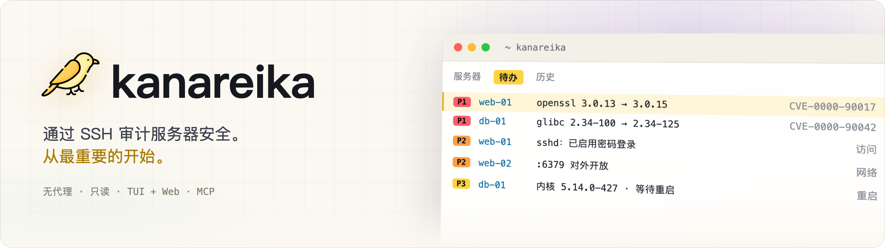
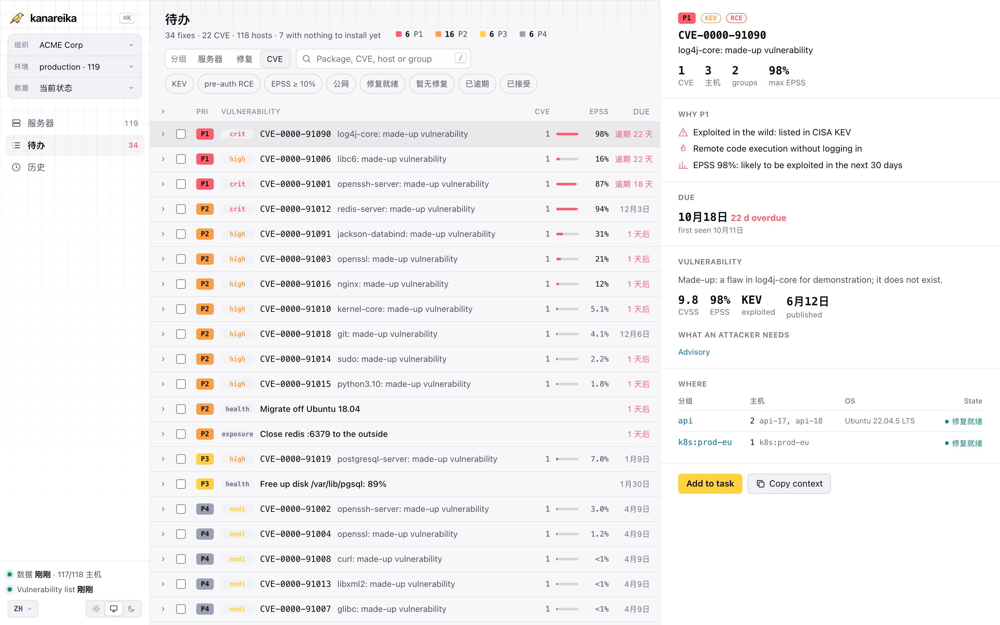

<h1><picture><source media="(prefers-color-scheme: dark)" srcset="../brand/banner-zh.webp"></picture></h1>

[](https://github.com/mikekosulin/kanareika/actions/workflows/ci.yml) [](https://github.com/mikekosulin/kanareika/actions/workflows/coverage.yml) [](https://github.com/mikekosulin/kanareika/releases/latest) [](../../LICENSE) [](https://github.com/mikekosulin/kanareika)

[English](../../README.md) · [Español](README.es.md) · [Français](README.fr.md) · [Português](README.pt.md) · [Русский](README.ru.md) · **中文** · [日本語](README.ja.md) · [한국어](README.ko.md)

无需代理、只读的 Linux 服务器安全审计（通过 SSH）。它排出先修什么：结合 KEV 和 EPSS 的 CVE、SSH 访问、暴露的端口、主机健康，每项都附带可回滚的修复步骤。终端界面、Web 界面和面向 AI 代理的 MCP 服务器，用起来完全一样。一个 Go 二进制文件，每个组织一个 YAML，无遥测，数据只留在你的机器上。

- **家庭实验室**：从 `~/.ssh/config` 中挑选主机，或粘贴 `user@host`。
- **自由职业者**：每个客户一个组织，之后可以再添加服务器。
- **企业**：粘贴主机列表、CSV 或 Ansible 清单；登录失败按原因分组，并给出修复方法。

### 终端界面

运行 `kanareika`。默认打开“待办”：最紧急的排在最前面。


### Web 界面

运行 `kanareika web`：在浏览器中查看相同的数据，以及最近 30 次运行的趋势。

<picture><source media="(prefers-color-scheme: dark)" srcset="../screenshots/web-zh.png"></picture>

<sub>演示数据，均为虚构。</sub>

### 安装

Homebrew（macOS、Linux）；formula 固定了版本及其校验和：

```bash
brew install mikekosulin/tap/kanareika
```

或使用安装脚本——先阅读，再运行：

```bash
curl -fsSLO https://raw.githubusercontent.com/mikekosulin/kanareika/main/install.sh
less install.sh
sh install.sh
```

脚本会选择适合本机的版本，校验校验和（如已安装 GitHub CLI，还会验证构建证明），并在安装到 `/usr/local/bin` 或 `~/.local/bin` 前询问确认；设置 `KANAREIKA_YES=1` 可跳过询问。

或手动安装（Linux、macOS）：

```bash
cd "$(mktemp -d)"
OS=$(uname -s | tr '[:upper:]' '[:lower:]')                 # linux, darwin
ARCH=$(uname -m | sed 's/x86_64/amd64/; s/aarch64/arm64/')  # amd64, arm64
FILE=kanareika-$OS-$ARCH.tar.xz
URL=https://github.com/mikekosulin/kanareika/releases/latest/download

curl -fsSLO "$URL/$FILE"
curl -fsSLO "$URL/SHA256SUMS"
sha256sum -c --ignore-missing SHA256SUMS  # macOS: shasum -a 256 -c --ignore-missing SHA256SUMS
gh attestation verify "$FILE" --repo mikekosulin/kanareika  # 可选，需要 GitHub CLI
tar -xJf "$FILE" kanareika
sudo install kanareika /usr/local/bin/  # 不用 sudo 时: install kanareika ~/.local/bin/
```

Windows（PowerShell）：

```powershell
Invoke-WebRequest https://github.com/mikekosulin/kanareika/releases/latest/download/kanareika-windows-amd64.zip -OutFile kanareika.zip; Expand-Archive kanareika.zip -DestinationPath kanareika
```

然后在 `kanareika` 文件夹中运行 `kanareika.exe`。ARM 设备请改用 `kanareika-windows-arm64.zip`。

### 启动

在终端中：

```bash
kanareika
```

或在浏览器中，地址为 http://127.0.0.1:8088（仅监听 localhost）：

```bash
kanareika web
```

首次启动时会引导你添加服务器（SSH 用户和密钥、主机、扫描授权）并运行第一次扫描；下载漏洞列表（约 210 MB）前会先询问。

### 用于脚本和 cron

创建组织，配置保存在 `orgs/<ORG_ID>.yml`：

```bash
kanareika org new <ORG_ID>
```

扫描该组织；扫描前会先检查配置文件并下载漏洞库：

```bash
kanareika scan <ORG_ID>
```

在其他端口运行 Web 界面（`--port 0` 自动选择空闲端口）：

```bash
kanareika web --port <PORT>
```

将终端界面连接到远程 Web：

```bash
kanareika tui --url http://<SERVER>:8088 --token <YOUR_SECRET_TOKEN>
```

离线环境：先在能联网的机器上导出漏洞库，

```bash
kanareika db export <BUNDLE.tar.gz>
```

再在离线机器上导入并离线扫描：

```bash
kanareika db import <BUNDLE.tar.gz>
kanareika scan <ORG_ID> --offline
```

其他所有命令：`kanareika --help`。

**四种使用方式，同一份数据和规则：**

- **TUI** — `kanareika`：`?` 查看按键，`o` 设置面板，`L` 切换语言。也可连接远程 Web。
- **Web** — `kanareika web`：概览、趋势、主机详情；可直接在页面上发起扫描。
- **命令** — 用于脚本和 cron。
- **MCP** — `kanareika mcp`：供 AI 智能体（Claude Code 等）使用的只读工具。

**检查内容：**

- **漏洞** — 通过内置于二进制文件中的 trivy 检查系统软件包、镜像、jar 和锁文件；在主机上核实向后移植（backport）的修复以及修复版本是否可用；按 KEV、EPSS、暴露面和无需认证的 RCE 划分 **P1–P4** 优先级。
- **访问与暴露** — SSH 密码登录、密钥、登录记录与攻击者、开放端口、防火墙、外部扫描。
- **健康** — 内核错误、磁盘、内存、时间同步、待重启。
- **修复** — 选中的操作会生成一份现成的任务，交给工程师或 AI 智能体：执行、验证、回滚。
- **安全设计** — 只读；组织之间相互隔离；主机密钥变化即拒绝连接；未获授权不扫描；Web 界面仅限 localhost（或使用令牌）。
- **隐私** — 没有遥测：不会向任何地方发送关于你或你的服务器的信息，报告只留在你的机器上。它只下载公开数据：漏洞库（ghcr.io，备用源为 mirror.gcr.io 和 public.ecr.aws）、CISA KEV（cisa.gov）、EPSS（FIRST，empiricalsecurity.com）以及 DB-IP Lite IP 库（db-ip.com），IP 查询在本地离线完成。就连内置 trivy 的遥测也已关闭。

**免责声明。** Kanareika 只报告它发现的问题，不保证发现全部问题。优先级和修复步骤仅供参考：在主机上执行任何操作前请先审阅。只审计你有权审计的服务器。本软件按“原样”提供，不附带任何担保（[MIT](../../LICENSE)）。

觉得好用？[点个 Star](https://github.com/mikekosulin/kanareika) · 有问题？[提交 issue](https://github.com/mikekosulin/kanareika/issues/new/choose)（请勿包含真实主机或地址）· 发现漏洞？[私下报告](../../SECURITY.md)

[组织文件格式](../org-file.md) · [更新日志](../../CHANGELOG.md) · [参与贡献](../../CONTRIBUTING.md) · [MIT](../../LICENSE)
