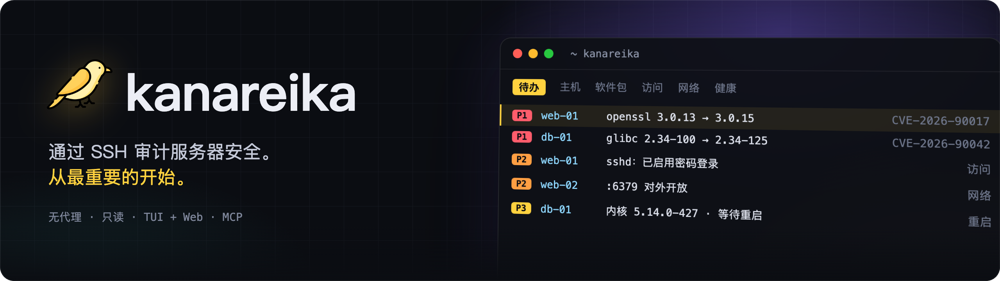
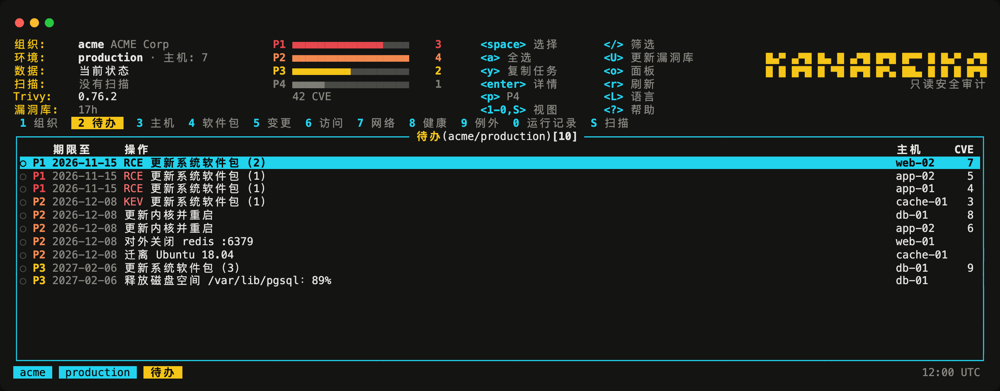
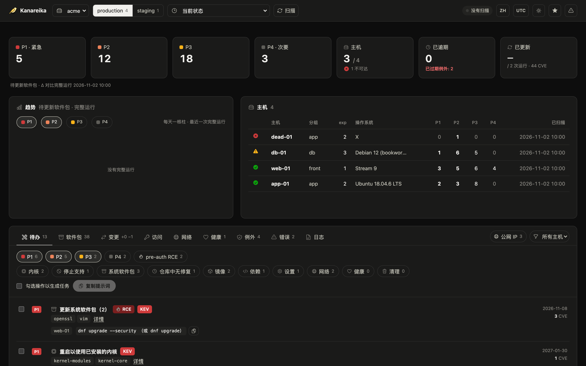

<h1></h1>

[](https://github.com/mikekosulin/kanareika/actions/workflows/ci.yml) [](https://github.com/mikekosulin/kanareika/actions/workflows/coverage.yml) [](https://github.com/mikekosulin/kanareika/releases/latest) [](../../LICENSE) [](https://github.com/mikekosulin/kanareika)

[English](../../README.md) · [Русский](README.ru.md) · **中文**

无需代理、只读的服务器安全审计（通过 SSH）：先修什么、谁能登录、什么暴露在外、主机是否健康——并给出可回滚的修复步骤。
一个二进制文件，每个组织一个 YAML，数据只留在你的机器上。

### 终端界面

运行 `kanareika`。默认打开“待办”：最紧急的排在最前面。



### Web 界面

运行 `kanareika web`：在浏览器中查看相同的数据，以及最近 30 次运行的趋势。



<sub>演示数据，均为虚构。</sub>

```bash
brew install mikekosulin/tap/kanareika   # macOS、Linux；或从 Release 下载二进制文件（含 Windows）
kanareika init                   # 在当前目录创建 orgs/、secrets/、reports/（或 --home DIR）
kanareika org new myorg          # 主机、跳板机和授权：orgs/myorg.yml
kanareika validate myorg
kanareika db update              # 漏洞库（离线环境：db export / db import）
kanareika scan myorg
kanareika                        # 终端界面
kanareika web                    # Web 界面，http://127.0.0.1:8088
```

**四种使用方式，同一份数据和规则：**

- **TUI**（主要）— `kanareika`：k9s 风格；`?` 查看按键，`o` 设置面板，`L` 切换语言。也可连接远程 Web：
  `kanareika tui --url http://host:8088 --token …`。
- **Web** — `kanareika web`：概览、趋势、主机详情；可直接在页面上发起扫描。
- **命令** — 用于脚本和 cron：`kanareika --help`。
- **MCP** — `kanareika mcp`：供 AI 智能体（Claude Code 等）使用的只读工具。

**检查内容：**

- **漏洞** — 通过内置于二进制文件中的 trivy 检查系统软件包、镜像、jar 和锁文件；在主机上核实回移补丁和修复是否可用；
  按 KEV、EPSS、暴露面和无需认证的 RCE 划分 **P1–P4** 优先级。
- **访问与暴露** — SSH 密码登录、密钥、登录记录与攻击者、开放端口、防火墙、外部扫描。
- **健康** — 内核错误、磁盘、内存、时间同步、待重启。
- **修复** — 选中的操作会生成一份现成的任务，交给工程师或 AI 智能体：执行、验证、回滚。
- **安全设计** — 只读；组织之间相互隔离；主机密钥变化即拒绝连接；未获授权不扫描；Web 界面仅限 localhost（或使用令牌）。

**免责声明。** Kanareika 只报告它发现的问题，不保证发现全部问题。优先级和修复步骤仅供参考：在主机上执行任何操作前请先审阅。
只审计你有权审计的服务器。本软件按“原样”提供，不附带任何担保（[MIT](../../LICENSE)）。

喜欢吗？[点个星](https://github.com/mikekosulin/kanareika) · 有问题？[提交 issue](https://github.com/mikekosulin/kanareika/issues/new/choose)
（请勿包含真实主机或地址）· 发现漏洞？[私下报告](../../SECURITY.md)

[组织文件格式](../org-file.md) · [更新日志](../../CHANGELOG.md) · [参与贡献](../../CONTRIBUTING.md) · [MIT](../../LICENSE)
